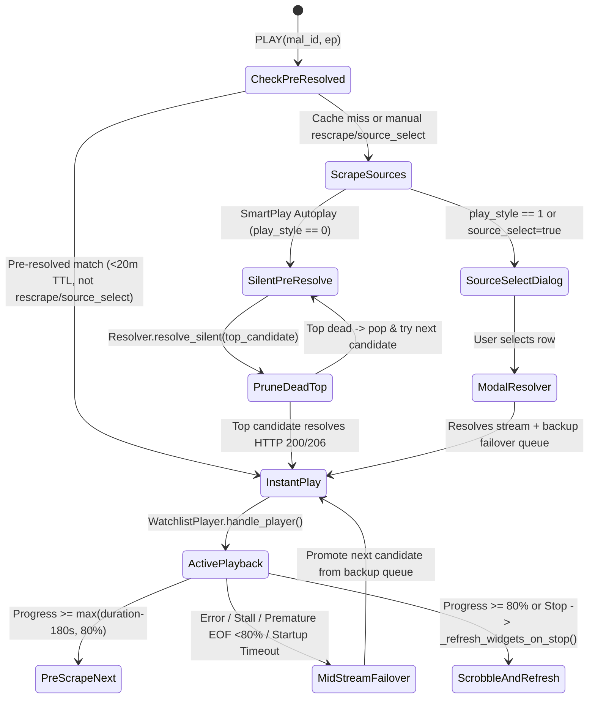

# Otaku-RPDev Core Algorithms, Scoring Formulas & State Machines

This reference specifies the mathematical formulas, relevance gates, state machines, and fallback trees that govern title matching, playback failover, subtitle selection, chapter/filler skipping, and tracker reconciliation.

---

## 1. Candidate Title Isolation, Scoring & 4-Tier Relevance Gating

Implemented across [`ui/source_utils.py`](../plugin.video.otaku.rpdev/resources/lib/ui/source_utils.py) and [`pages/__init__.py`](../plugin.video.otaku.rpdev/resources/lib/pages/__init__.py).

### 1.1 Title Isolation (`isolate_show_title(release_title)`)
Before matching a torrent or embed release title against a target anime, `isolate_show_title()` strips non-title release noise in a deterministic order:
1. Leading fansub/release group tags in brackets (`[SubsPlease]`, `[Erai-raws]`, `(Hi10)`).
2. File extensions (`.mkv`, `.mp4`, `.avi`) and trailing CRC32 checksums (`[A1B2C3D4]`).
3. Episode/Season/Batch indicators (`- 01`, `S01E01`, `Season 2`, `Part 2`, `Ep 01-12`, `[Batch]`) and everything following the episode delimiter (codec, resolution, audio tags).
4. Punctuation normalization (`clean_title()`): lowercases, normalizes Unicode diacritics/apostrophes, and collapses whitespace.

### 1.2 Candidate Title Scoring (`score_title_candidate(candidate_title, target_titles) -> 0..200`)
`score_title_candidate()` evaluates the isolated show title against all canonical target titles (plus sequel season aliases from `expand_sequel_season_aliases()`):

| Match Tier | Score Range | Criteria & Penalties |
|---|---|---|
| **Exact Match** | `140` – `200` | Exact normalized string equality with primary title or official synonym (`180`–`200`), or exact match after sequel season alias expansion (`>= 140`). |
| **Strong Match** | `95` – `139` | High token-set overlap (`>= 0.85` Jaccard/containment) with matching season/part number and zero conflicting sequel/spin-off tokens. |
| **Acceptable Match** | `45` – `94` | Partial token overlap (`>= 0.65`) where core distinctive tokens match and no disqualifying derivative markers exist. |
| **Derivative / Rejected** | `0` – `40` | Prefix/suffix collision with a distinct franchise or derivative work (e.g., `"Re:Monster"` matching `"Monster"`, `"Bleach: Thousand-Year Blood War"` matching Season 1 `"Bleach"` without season alias, or mismatched sequel number). Filtered out by `filter_sources()` (`score <= 40`). |

### 1.3 Pre-Debrid & Sort-Stage Sequel Alias Parity (`expand_sequel_season_aliases`)
Arc-subtitled sequels (e.g., *"Kimetsu no Yaiba: Yuukaku-hen"* or *"Bleach: Sennen Kessen-hen"*) are frequently released by English Dub / Dual-Audio groups under season-numbered titles (*"Demon Slayer Season 2"*, *"Bleach Season 17"*).
- `source_utils.expand_sequel_season_aliases(titles, season)` **must** be invoked inside **both**:
  1. `source_utils.filter_sources()` **prior** to `Debrid().torrentCacheCheck()` (so season-numbered releases survive pre-debrid filtering).
  2. `pages/__init__.py:sortSources()` (so surviving releases receive Tier 3 exact relevance scores `>= 140`).

### 1.4 4-Tier Relevance Gate in `sortSources()`
To prevent a tangential 4K/1080p match from outranking an exact 720p/1080p match during SmartPlay autoplay, `sortSources()` partitions candidates into 4 relevance tiers **before** applying user resolution/size/seeder sort rules:
- **Tier 3 (`score >= 140`)**: Exact / canonical alias matches.
- **Tier 2 (`95 <= score < 140`)**: Strong token matches.
- **Tier 1 (`45 <= score < 95`)**: Acceptable fallback matches.
- **Tier 0 (`score < 45` or unscored)**: Weak / untitled matches (only considered if Tiers 3–1 are empty).

---

## 2. Playback Resolution, Zero-Wait Handoff & 4-Reason Failover State Machine

Implemented in [`routes/playback.py`](../plugin.video.otaku.rpdev/resources/lib/routes/playback.py), [`windows/resolver.py`](../plugin.video.otaku.rpdev/resources/lib/windows/resolver.py), and [`ui/player.py`](../plugin.video.otaku.rpdev/resources/lib/ui/player.py).

### 2.1 Normal Scrape vs `is_rescrape=True` (`Rescrape` & `Source Select` Parity)
- **Normal SmartPlay Scrape (`is_rescrape=False`)**: Honors `general.timeout`, uses cached scrape results if fresh (`cache.db`), respects `AdaptiveCircuitBreaker` cooldowns, and terminates early as soon as the user's target quality tier and minimum source threshold are satisfied.
- **Manual `Rescrape` or `Source Select` (`is_rescrape=True`)**:
  1. Bypasses `stream_cache` and `otaku.preResolved_*` handoff.
  2. Clears HiAnime mirror negative cooldowns (`HiAnime.reset_mirror_cooldowns()`).
  3. Enforces a minimum **`30s` scraper timeout floor** (`max(configured_timeout, 30)`).
  4. Disables early termination (`early_exit_enabled = False`) and bypasses circuit-breaker skips so every enabled scraper and mirror returns its complete candidate pool.

### 2.2 The 4 Mid-Stream & Startup Failover Triggers (`WatchlistPlayer`)
When `Resolver` hands off to `WatchlistPlayer`, it passes the remaining ranked candidates as a `failover_sources` queue. `WatchlistPlayer` automatically promotes and resolves the next candidate when any of four conditions occur:
1. **Startup Timeout**: `isPlayingVideo()` does not become true within the startup deadline (`12s`).
2. **`onPlayBackError` Event**: Kodi's C++ demuxer/player emits a fatal playback error callback.
3. **Premature Stream EOF (`onPlayBackEnded` at `< 80%` progress)**: CDN connection drops mid-episode before scrobble completion threshold (`progress < 0.80` and `current_time > 15s`), resuming from the exact drop timestamp (`seekTime`).
4. **Repeated Buffer Stalls**: Consecutive zero-progress playback stalls exceeding the stall window threshold.

---

## 3. Subtitle Selection, Sparse Signs-Only Upgrade & Timing Sync Math

Implemented across [`ui/player.py`](../plugin.video.otaku.rpdev/resources/lib/ui/player.py), [`ui/embed_extractor.py`](../plugin.video.otaku.rpdev/resources/lib/ui/embed_extractor.py), [`windows/resolver.py`](../plugin.video.otaku.rpdev/resources/lib/windows/resolver.py), [`subtitles/`](../plugin.video.otaku.rpdev/resources/lib/subtitles/), and [`service.subtitles.otaku.rpdev/service.py`](../service.subtitles.otaku.rpdev/service.py).

### 3.1 Dual BCP 47 & ISO 639-2 Language Matching (`is_language_match`)
Kodi 20/21 reports stream languages as 3-letter ISO 639-2 codes (`jpn`, `eng`), whereas Kodi 22 (Piers) often reports 2-letter BCP 47 codes (`ja`, `en`) or `"und"`.
- `is_language_match(stream_lang, target_lang)` normalizes both sides against a unified alias map (`{'ja', 'jpn', 'japanese'}`, `{'en', 'eng', 'english'}`).
- **Single-Track `lang="und"` English Dub Heuristic**: When an embed stream has a single audio track tagged `"und"` (or empty) and `otaku.active_source_is_dub == "true"` (or the release title is classified as `lang == 2` Dub), `WatchlistPlayer` treats the audio track as English Dub rather than Japanese Sub.

### 3.2 External `.vtt` Validation & Sparse Signs-Only Detection (`embed_extractor.get_sub`)
1. **Byte-0 Hygiene & Cue Validation**: `get_sub()` strips UTF-8 BOM (`\ufeff`) and leading whitespace to byte 0, verifies valid `.vtt`/`.srt`/`.ass` cue headers (rejecting HTML/JSON Cloudflare pages that return HTTP 200, falling back to origin `?url=` if a proxy fails), writes via `atomic_write_text()`, and appends a unique per-play `sub_tag` nonce to prevent Kodi 22 `special://temp/` `g_directoryCache` collisions.
2. **Sparse Signs & Songs Detection (`< 45` cues)**: English-dubbed embeds (e.g., HiAnime MegaPlay) frequently bundle a tiny `.vtt` file containing only `< 45` cues for on-screen Japanese text signs.
   - When `general.subtitles.mode` is **Full Dialogue** and `get_sub()` detects `< 45` cues on a Dub stream, it sets `is_sparse_signs = True` and **skips** attaching the Signs-only `.vtt` at `Resolver` / `playback.py` startup so `WatchlistPlayer._auto_fetch_subtitles()` automatically fetches full English dialogue subtitles from `service.subtitles.otaku.rpdev` (Animetosho/Jimaku/OpenSubtitles).

### 3.3 Subtitle Scoring (`score_result`) & `1.03` PAL-to-NTSC Rescaling Math
In `service.subtitles.otaku.rpdev`:
- **Candidate Scoring (`score_result`)**: Ranks candidates by ID match (`mal_id`/`anidb_id` exact match `+50`), exact episode number match (`+40`, mismatched episode `-100`), release group affinity (`SubsPlease`, `Erai-raws`, `HorribleSubs` `+15`), format preference (`.ass`/`.ssa` `+10` over `.srt`/`.vtt`), and provider trust tier (`Animetosho` / `Jimaku` > `SubDL` > `OpenSubtitles`).
- **2-Phase Auto-Download Validation**: During silent background auto-download (`service.py`), candidates are checked for episode number parity and playback-abort status (`not xbmc.Player().isPlaying()`) **before** downloading or calling `setSubtitles()`, skipping mismatched fallback packs cleanly.
- **Post-Download Timing & SDH Processing ([`subtitles/download.py`](../plugin.video.otaku.rpdev/resources/lib/subtitles/download.py))**:
  - For every cue timestamp $(t_{\text{start}}, t_{\text{end}})$ in milliseconds:
    $$t' = \max\left(0,\ \text{round}\left(t \times f_{\text{fps}} + \Delta_{\text{offset\_ms}}\right)\right)$$
  - Where $f_{\text{fps}} = 1.03$ when 25fps PAL -> 23.976fps NTSC rescaling is enabled (or $1.0$ otherwise), and $\Delta_{\text{offset\_ms}}$ is the global millisecond shift (`-10,000 ms` to `+10,000 ms`).

---

## 4. Chapter / OP-ED 3-Tier Fallback & 4-Tag Filler/Canon Auto-Skip Matrix

### 4.1 3-Tier Chapter / OP-ED Detection Chain ([`ui/player.py`](../plugin.video.otaku.rpdev/resources/lib/ui/player.py))
1. **Tier 1 (Kodi 22 Native Demuxer Chapters)**: Queries `Player.GetChapters` via JSON-RPC after `onPlayBackStarted`. Matches chapter names against OP/ED regexes (`Opening`, `OP`, `Intro`, `Ending`, `ED`, `Outro`, `Credits`).
2. **Tier 2 (HTTP Range `ffprobe` Inspection)**: If Tier 1 returns no chapters, probes the first/last MKV headers over HTTP byte-range via `ffprobe` (`endpoints/chapter_probe.py`).
3. **Tier 3 (Community Timestamp APIs + Series Offset)**: Queries `AniSkip` -> `Anime-Skip` -> `IntroDB` for `(mal_id, episode, duration)`, then shifts start/end timestamps by per-series `intro_offset_s` and `outro_offset_s` from `series_overrides`.

### 4.2 4-Tag Episode Classification & Auto-Skip Decision Matrix
Episodes are classified in [`endpoints/anime_filler.py`](../plugin.video.otaku.rpdev/resources/lib/endpoints/anime_filler.py) and badged in [`indexers/__init__.py`](../plugin.video.otaku.rpdev/resources/lib/indexers/__init__.py). Note that for shows with a sparse filler list (where AnimeFillerList only enumerates filler episodes, e.g., *Bleach*), any episode number not present in the filler dictionary defaults to **`Canon`** (`[CANON]`).

| Episode Tag & Badge | Raw `filler` DB Value | `Highlight Only` (`none`) | `Skip Filler & Recap` (`skip`) | `Skip All Including Mixed` (`skip_mixed`) |
|---|---|---|---|---|
| **`[CANON]`** (Green) | `'Canon'`, `'Manga Canon'`, `'Anime Canon'` | Play normally | Play normally | Play normally |
| **`[MIXED]`** (Gold) | `'Mixed Canon/Filler'` | Play normally | Play normally | **Auto-skip to next non-filler episode** |
| **`[FILLER]`** (Red) | `'Filler'` | Play normally | **Auto-skip to next non-filler episode** | **Auto-skip to next non-filler episode** |
| **`[RECAP]`** (Orange) | `'Recap'` | Play normally | **Auto-skip to next non-filler episode** | **Auto-skip to next non-filler episode** |

---

## 5. Multi-Tracker Conflict Resolution & Adaptive Circuit Breaker

### 5.1 Multi-Tracker Watchlist Conflict Resolution ([`WatchlistFlavor/__init__.py`](../plugin.video.otaku.rpdev/resources/lib/WatchlistFlavor/__init__.py))
When multiple trackers (`MAL`, `AniList`, `Kitsu`, `Simkl`) are enabled simultaneously:
- **`highest_progress` (Default)**: Selects $\max(\text{eps\_watched})$ across all linked trackers so the user never loses progress recorded on another device.
- **`primary_wins`**: Always trusts the progress and status of the primary display flavor (`watchlist.update.flavor`).
- **`latest_updated`**: Selects the record with the newest upstream `updated_at` ISO timestamp.
- **Durable Retry Queue (`scrobble_retry_queue`)**: Failed scrobble mutations increment `attempts`, compute exponential backoff $\Delta t = \min(3600,\ 60 \times 2^{\text{attempts}})$, log `last_error`, and automatically purge rows belonging to services the user has disabled (whenever `enabled_watchlists()` is non-empty).

### 5.2 3-Tier `AdaptiveCircuitBreaker` State Machine ([`ui/client.py`](../plugin.video.otaku.rpdev/resources/lib/ui/client.py))
- **`CLOSED`**: Normal operation. Consecutive timeouts / 5xx / unsolvable Cloudflare blocks increment `failure_count`.
- **`OPEN` (Escalating Cooldown Tiers)**: Trips when `failure_count >= threshold` (or immediately `<500ms` on a hard Cloudflare IP block / interactive Turnstile challenge):
  - **Tier 1**: `300s` (5 minutes)
  - **Tier 2**: `900s` (15 minutes)
  - **Tier 3**: `3600s` (60 minutes)
- **`HALF_OPEN`**: Once cooldown expires, allows a single probe request; success resets to `CLOSED` (`failure_count = 0`), while failure escalates to the next `OPEN` tier.
