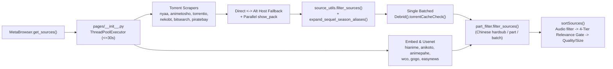

# Otaku-RPDev Architecture & Subsystem Guide

Detailed reference for developers and contributors working on `plugin.video.otaku.rpdev` and `context.otaku.rpdev`. For strict engineering invariants and guardrails, see [AGENTS.md](../AGENTS.md).

---

## 1. Repository & Module Map

```text
Otaku-RPDev/
├── plugin.video.otaku.rpdev/
│   ├── default.py                      # Plugin router dispatch (async changelog offload)
│   ├── service.py                      # Background service (clean_settings, 15m OAuth refresh, passive WAL checkpoint)
│   └── resources/
│       ├── settings.xml                # 467 declared settings (340 user-visible levels 0-3, 127 internal level 4)
│       ├── data/domains.json           # Dynamic provider domain registry & mirror lists
│       ├── skins/Default/1080i/        # 38 custom 1080i WindowXML / WindowXMLDialog templates
│       └── lib/
│           ├── Main.py & routes/       # Modular route handlers (playback, tools, search, watchlist, etc.)
│           ├── pages/                  # Torrent, Usenet & embed scrapers + orchestrator (__init__.py)
│           ├── debrid/                 # Real-Debrid, Premiumize, AllDebrid, Debrid-Link, TorBox, EasyDebrid, Easynews
│           ├── ui/                     # control.py, database.py, client.py, player.py, source_utils.py, embed_extractor.py, domains.py
│           ├── subtitles/              # Native multi-provider subtitle engine & dual BCP 47 / ISO 639-2 matcher
│           ├── endpoints/              # AniList, MAL, TMDb, TVDB, AniZip, AnimeFiller, AniSkip, IntroDB
│           ├── WatchlistFlavor/        # AniList, MyAnimeList, Kitsu, Simkl watchlist sync & views
│           └── windows/                # Custom WindowXML controllers (resolver, source_select, get_sources, anichart, etc.)
├── context.otaku.rpdev/                # Standalone context menu add-on + 580 coloured/white studio logo packs
├── scripts/                            # release_addon.py, audit_function_coverage.py, test_kodi_installs.py, kodi_e2e_mock_server.py
├── tests/                              # 991+ hermetic offline tests (dual Kodi 21/22 profile mocks, AST lint, 576-title dataset)
└── docs/                               # ARCHITECTURE.md, CONCERNS.md, CONFIGURATION_GUIDE.md, PROJECT_REVIEW_REPORT.md
```

---

## 2. Scraping, Filtering & Relevance Pipeline



Key design principles:
- **Zero-`soupsieve` HTML parsing**: Kodi's bundled `beautifulsoup4` omits `soupsieve`; all scrapers exclusively use `.find()` / `.find_all()`.
- **Parallel single-batch scraping (`nyaa.py`, `animetosho.py`)**: Episode queries and `show_pack` queries run in one `utils.parallel_process` pass, deduplicate candidate hashes, and execute a single batched `Debrid().torrentCacheCheck()` so scrapers complete in ~3–4s well inside a 15s `general.timeout`.
- **Automatic direct ↔ `translate.goog` failover**: If a scraper's configured host returns an HTTP error or missing content container, it transparently retries the opposite host (`animetosho.net` ↔ `animetosho-net.translate.goog`, `nyaa.si` ↔ `nyaa-si.translate.goog`) and sticky-switches for the remainder of the scrape.
- **Unified 0–200 scoring (`source_utils.score_title_candidate`)**: Exact matches (`>=140`), aliases (`140`), approved descriptors (`115–125`), and strict rejection of derivatives/wrong seasons (`<=40`). Sequel season aliases (`expand_sequel_season_aliases`) are applied both pre-Debrid (`filter_sources`) and post-Debrid (`sortSources`).

---

## 3. Playback, Zero-Wait Binge & External Subtitles

- **Zero-Wait Pre-Resolved Playback**: During active playback, `WatchlistPlayer` pre-scrapes and pre-resolves the next episode (bypassing scraping entirely when a cached season pack covers `ep + 1`), storing lightweight metadata in `Window(10000)` (`otaku.preResolved_*`, capped under 64 KB UTF-8).
- **Chapter & Auto-Skip Priority**:
  1. Native Kodi 22 demuxer chapters (`Player.GetChapters` JSON-RPC) — queried first, decoupled from `ffprobe`.
  2. Pre-probed container chapters (`ffprobe_chapters.attach_to_linkinfo`).
  3. AniSkip / Anime-Skip / IntroDB community timestamps (applied asynchronously).
- **Kodi 22 External Subtitle Contract (`embed_extractor.get_sub`)**:
  - Aligned with Kodi 22 `CDVDFactorySubtitle::CreateParser()`: strips UTF-8 BOM + leading whitespace to byte 0, validates `.vtt`/`.srt`/`.ass` cues, auto-promotes hour-less VTT cues (`MM:SS.mmm --> MM:SS.mmm`), rejects HTML/JSON/cue-less stubs, and falls back to origin `source_url` / `?url=` even on HTTP 200 error bodies.
  - Uses unique per-play `sub_tag` nonces (`{mal_id}_{episode}_{ms}`) in both `resolver.py` and `routes/playback.py` to avoid Kodi's `special://temp/` `g_directoryCache` collisions and skips `del_subs()` in `onPlayBackEnded()` when a next playlist item is queued.

---

## 4. SQLite Concurrency & Low-RAM Architecture

| Database | Mode | Notes |
|---|---|---|
| `cache.db`, `search.db` | Read-Write WAL | Thread-local pools keyed by `(abs_path, is_readonly)`, `threading.RLock()` + jittered `execute_write_with_retry()`, passive WAL checkpoints in `service.py`, automatic quarantine & recovery on `DatabaseError`. |
| `info.db`, `mappings.db` | Read-Only URI (`?mode=ro`) | Static reference dictionaries; skips all write PRAGMAs and WAL checkpoints; safe for concurrent access from `context.otaku.rpdev`. |

- **64 KB Window Property Ceiling**: `_WindowProxy.setProperty` enforces `<= 65,536` UTF-8 bytes; large payloads (e.g., reviews, multipage caches) reside in SQLite WAL tables.
- **Modal Dialog Cleanup**: Every `WindowXML` / `WindowXMLDialog` is closed and deleted (`del dlg`) inside `try ... finally:` blocks to prevent C++ heap leaks on 1 GB Android TV devices.

---

## 5. Dual Kodi 20/21 & Kodi 22 Testing Architecture

- **Hermetic Offline Suite (`tests/`)**: `tests/conftest.py` blocks live sockets; `tests/kodi_profile.py` simulates both Kodi 21 (`MockInfoTagVideo21`, ISO 639-2 `jpn`/`eng`, empty `Player.GetChapters`) and Kodi 22 (`MockInfoTagVideo22`, strict SWIG non-null contracts, BCP 47 `ja`/`en`, native chapters) with real `settings.xml` schema validation and real 1080i skin XML control checks.
- **Headless Flatpak E2E (`scripts/test_kodi_installs.py` & `scripts/kodi_e2e_mock_server.py`)**: Runs real `tv.kodi.Kodi//stable` (21.3) and `tv.kodi.Kodi//beta` (22.0) under `xvfb-run` with an ephemeral loopback mock server serving Range-capable MKV streams (`sample_chapters.mkv`), external subtitles, and mock APIs.
