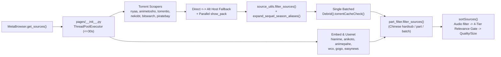

# Otaku-RPDev Architecture & Subsystem Guide

Detailed reference for developers and contributors working on `plugin.video.otaku.rpdev`, `service.otaku.rpdev`, `context.otaku.rpdev`, and `service.subtitles.otaku.rpdev`. For strict engineering invariants and guardrails, see [AGENTS.md](../AGENTS.md). For deep-dive specifications, see:
- **Features & Integrations**: [FEATURES.md](FEATURES.md) & [INTEGRATIONS.md](INTEGRATIONS.md)
- **Schemas & State**: [DATA_MODELS_AND_STATE.md](DATA_MODELS_AND_STATE.md)
- **Routes & WindowXML UI**: [ROUTING_AND_UI_MAP.md](ROUTING_AND_UI_MAP.md)
- **Scoring Math & State Machines**: [ALGORITHMS_AND_LOGIC.md](ALGORITHMS_AND_LOGIC.md)
- **Scrapers, Extractors & Debrid**: [SCRAPERS_AND_EXTRACTORS.md](SCRAPERS_AND_EXTRACTORS.md)
- **Testing & Inventory**: [TESTING.md](TESTING.md) & [TESTS.md](TESTS.md)

---

## 1. Repository & Module Map

```text
Otaku-RPDev/
├── plugin.video.otaku.rpdev/           # v6.7.0 primary video add-on
│   ├── default.py                      # Plugin router dispatch (async changelog offload)
│   ├── service.py                      # Thin backwards-compatible shim delegating to otaku_service.{daemon,sync}
│   └── resources/
│       ├── settings.xml                # 455 declared settings across 10 categories (336 user-visible levels 0-3, 119 internal level 4)
│       ├── data/domains.json           # Dynamic provider domain registry & mirror lists
│       ├── skins/Default/1080i/        # 41 custom 1080i WindowXML / WindowXMLDialog templates
│       └── lib/
│           ├── Main.py & routes/       # Explicit re-exports + modular routes (playback, history, subtitles, tools, search, watchlist)
│           ├── pages/                  # Torrent, Usenet & embed scrapers + orchestrator (__init__.py)
│           ├── debrid/                 # Real-Debrid, Premiumize, AllDebrid, Debrid-Link, TorBox, EasyDebrid, Easynews
│           ├── ui/                     # control.py (dual-addon proxy + epoch sync), database.py, database_sync.py, client.py, player.py, source_utils.py, embed_extractor.py, domains.py (AdaptiveCircuitBreaker), settings_manager.py
│           ├── subtitles/              # Subtitle Intelligence v2 (8 providers, SDH stripper, fallback, dual BCP 47 / ISO 639-2 matcher)
│           ├── endpoints/              # AniList, MAL, TMDb, TVDB, AniZip, AnimeFiller, AniSkip, IntroDB
│           ├── WatchlistFlavor/        # AniList, MyAnimeList, Kitsu, Simkl sync, Conflict Engine & Drift Auditor
│           └── windows/                # Custom WindowXML controllers (resolver, source_select, get_sources, filter_select, stats_window, anichart, etc.)
├── service.otaku.rpdev/                # v1.0.0 background daemon (xbmc.service) + shared module (xbmc.python.module)
│   ├── service.py                      # Startup readiness check, migration, standby-aware loop, <2s teardown
│   └── resources/
│       ├── settings.xml                # 61 declared settings across 3 categories (Cache, Maintenance, Solvers & Network)
│       └── lib/otaku_service/          # migration.py (self-contained), daemon.py, sync.py
├── context.otaku.rpdev/                # v1.0.50 standalone widget-aware context menu add-on + 494 deduplicated PNGs per style (coloured/white)
├── service.subtitles.otaku.rpdev/      # v1.0.3 native Kodi xbmc.subtitle.module companion add-on (OSD search & auto-download)
├── scripts/                            # verify_all.py, qa_fast.py, e2e_v630_suite.py, audit_onn_logs.py, release_addon.py, audit_function_coverage.py, test_kodi_installs.py
├── tests/                              # 1,119 discover tests + 145 E2E suite tests (dual Kodi 21/22 mocks, AST/quality/doc lints, 576-title dataset)
└── docs/                               # README.md, FEATURES.md, INTEGRATIONS.md, ARCHITECTURE.md, PLANS.md, TESTING.md, TESTS.md, AUTOMATION.md, CONCERNS.md, CONFIGURATION_GUIDE.md, teamwork/
```

---

## 2. Scraping, Filtering & Relevance Pipeline



Key design principles:
- **Zero-`soupsieve` HTML parsing**: Kodi's bundled `beautifulsoup4` omits `soupsieve`; all scrapers exclusively use `.find()` / `.find_all()`.
- **Parallel single-batch scraping (`nyaa.py`, `animetosho.py`)**: Episode queries and `show_pack` queries run in one `utils.parallel_process` pass, deduplicate candidate hashes, and execute a single batched `Debrid().torrentCacheCheck()` so scrapers complete in ~3–4s well inside a 15s `general.timeout`.
- **Automatic direct ↔ `translate.goog` failover**: If a scraper's configured host returns an HTTP error or missing content container, it transparently retries the opposite host (`animetosho.net` ↔ `animetosho-net.translate.goog`, `nyaa.si` ↔ `nyaa-si.translate.goog`) and sticky-switches for the remainder of the scrape.
- **Unified 0–200 scoring (`source_utils.score_title_candidate`)**: Exact matches (`>=140`), aliases (`140`), approved descriptors (`115–125`), and strict rejection of derivatives/wrong seasons (`<=40`). Sequel season aliases (`expand_sequel_season_aliases`) are applied both pre-Debrid (`filter_sources`) and post-Debrid (`sortSources`).
- **Unified Adaptive Circuit Breaker (`domains.AdaptiveCircuitBreaker`)**: Tracks failures across all provider classes (`torrent`, `embed`, `subtitle`, `metadata`, `debrid`) using exponential cooldown tiers (`300s` $\rightarrow$ `900s` $\rightarrow$ `3600s`), `HALF_OPEN` recovery probes, and `Window(10000)` persistence (`pages.circuit_breaker` / `ScraperCircuitBreaker` aliased cleanly).
- **HTTP Transport, WAF, Query Joining & Embed Resilience**:
  - Cast timeouts via `float(timeout)` (never `int(timeout)`), join parameters with `'&' if '?' in url else '?'` (`domains.join_url()` for `translate.goog` `?_x_tr_*`), probe redirects with `Range: bytes=0-0` + `limit=1`, normalize base URLs with `.rstrip('/')` and smart quotes before slugging, and parse JSON strictly via `control.safe_json()` / `control.loads_json()` / `r.json(default={})`.
  - Probe TCP port `443` HTTPS endpoints before port `53` in `control.is_internet_available()`. Protect `AdaptiveCircuitBreaker` from false escalation during device Wi-Fi/DNS dropouts via the shared 15s `ConnectivityGate` (`>= 2` distinct failing hostnames within 5s or failed internet probe; `otaku.dns_gate_until`), and use `'returnOnlyCookies': False` for FlareSolverr JA3/JA4 TLS parity with fast-fail on hard Cloudflare WAF blocks.
  - Record bounded (`<= 20` samples) per-provider scrape latency p90 metrics for conditional embed-grace extensions when cached torrent yield is `0`, guard debrid quota saturation (`debrid.quota_guard`, `NF-17`) with opt-in Tier-3 Lazy Top-N probing (`debrid.lazy_cache_probe`), enforce `general.memory_watermark_mb` (`900 MB` RSS / `2600 MB` VmSize) on 32-bit ARM hosts (`C-37`), and emit single-line `OTAKU_METRIC` telemetry events aggregated by `scripts/audit_onn_logs.py`.
  - Process WCO SUB/DUB sequentially (`inc/embed/index.php` + `/ad-verify`), retain multi-server fallback lists, check `Goldenfreddy0703/Otaku` history/PRs and evaluate `tmdb_mapping_match()` before fuzzy matching, keep `BrowserBase`/`AniListBrowser`/`MalBrowser`/`OtakuBrowser` signatures synced, reject proxy-only scrapers, and keep defunct scrapers as 0ms `[]` stubs.
- **Per-Series `episode_offset` Isolation (`MetaBrowser.get_sources`)**: Applies `series_overrides.episode_offset` strictly to outbound scraper `actionArgs['episode']` while keeping `canonical_episode` untouched for local history and remote watchlist scrobbling.

---

## 3. Playback, Zero-Wait Binge & Subtitle Intelligence v2

- **Zero-Wait Pre-Resolved Playback**: During active playback, `WatchlistPlayer` pre-scrapes and pre-resolves the next episode (pruning failing lead candidates in `resolve_silent()` and saving the remaining list via `database.set_episode_sources()`), bypassing scraping entirely when a cached season pack covers `ep + 1`.
- **Filler/Canon Badges & Binge Auto-Skip**: `endpoints/anime_filler.py:classify_filler_tag()` and `indexers/__init__.py` append colorized `[CANON]` / `[MIXED]` / `[FILLER]` / `[RECAP]` badges (`interface.filler.badges`, defaulting untagged episodes in sparse filler-mapped shows like *Bleach* to `Canon`), while `WatchlistPlayer.build_playlist()` excludes filler/recap (`Skip Filler & Recap`, replaying Canon+Mixed) or all non-canon (`Skip All Including Mixed`, playing only Canon), preserving the list if all remaining episodes would be skipped. On playback stop/end, `WatchlistPlayer._refresh_widgets_on_stop()` calls `control.clearSettingsCache()` and `control.execute('Container.Refresh')` to refresh Kodi Home Screen widgets.
- **Chapter & Auto-Skip Priority**:
  1. Native Kodi 22 demuxer chapters (`Player.GetChapters` JSON-RPC) — queried first, decoupled from `ffprobe`.
  2. Pre-probed container chapters (`ffprobe_chapters.attach_to_linkinfo`).
  3. AniSkip / Anime-Skip / IntroDB community timestamps (with per-series `intro_offset_s` / `outro_offset_s` adjustments from `series_overrides`).
- **Kodi 22 External Subtitle Contract & Subtitle Intelligence v2 (`embed_extractor.py` & `subtitles/`)**:
  - Aligned with Kodi 22 `CDVDFactorySubtitle::CreateParser()`: strips UTF-8 BOM + leading whitespace to byte 0, validates `.vtt`/`.srt`/`.ass` cues, auto-promotes hour-less VTT cues, rejects HTML/JSON/cue-less stubs with origin fallback even on HTTP 200 error bodies, and registers `special://temp/` URIs in `g_directoryCache` via `control.atomic_write_text(..., vfs_path=...)` (`os.listdir()` in `del_subs()`, never `xbmcvfs.listdir()`).
  - Detects sparse `<45`-cue Signs-only embed `.vtt` sidecars (`otaku.embed_sub_signs_only`) and clears stale flags between episodes to auto-upgrade to Full Dialogue across 6 providers (`opensubtitles`, `subdl`, `subsource`, `podnadpisi`, `bsplayer`, `addic7ed`).
  - `subtitles/download.py:strip_sdh_hearing_impaired_tags()` (`subtitles.strip_sdh_tags`) removes SDH brackets/speaker prefixes while preserving ASS `{...}` override tags; `auto_download_subtitles()` falls through failed candidates with circuit-breaker health tracking.

---

## 4. SQLite Concurrency, Low-RAM & Watchlist Sync Architecture

| Database | Mode | Notes |
|---|---|---|
| `cache.db`, `search.db`, `malSync.db` | Read-Write WAL | `malSync.db` (`SCHEMA_VERSION = '1.0.14'`) stores `shows`, `episodes`, `shows_meta`, `show_data`, `watchlist_cache` / `v_watchlist_items`, `series_overrides`, and `scrobble_retry_queue`. `SyncDatabase._ensure_column_migrations()` runs `PRAGMA table_info` + `ALTER TABLE` unconditionally on startup so mid-sprint columns never drift. |
| `info.db`, `mappings.db` | Read-Only URI (`?mode=ro`) | Static reference dictionaries; skips all write PRAGMAs and WAL checkpoints while still enforcing `PRAGMA mmap_size = 0` on `is_low_memory()` (`C-37`); safe for concurrent reads from `context.otaku.rpdev`. `service.update_mappings_db()` supports `.xz`/`.gz`, SHA-256 verification, `PRAGMA quick_check(1)` staging, `mappings.db.bak` backup, and automatic corruption rollback. |

- **Multi-Tracker Conflict Engine & Drift Auditor (`WatchlistFlavor/` & `WatchlistIntegration.py`)**: Resolves multi-tracker progress using `watchlist.sync.conflict_policy` (`0=highest_progress`, `1=primary_wins`, `2=latest_updated`), persists HTTP 429/5xx scrobble failures with `Retry-After` + exponential backoff into `scrobble_retry_queue` (replayed in `service.py`), exposes `watchlist_telemetry`, and provides `watchlist_drift_auditor` with dry-run mutation counts + confirmation dialogs.
- **64 KB Window Property Ceiling**: `_WindowProxy.setProperty` enforces `<= 65,536` UTF-8 bytes; large payloads reside in SQLite WAL tables.
- **Modal Dialog Cleanup**: Every `WindowXML` / `WindowXMLDialog` is closed and deleted (`del dlg`) inside `try ... finally:` blocks, and `SettingsBackupDialog` / `settings_manager.py` backs up and restores `series_overrides` alongside settings/logins.

---

## 5. Dual Kodi 20/21 & Kodi 22 Testing Architecture

- **Unified Multi-Silo Gate (`scripts/verify_all.py`)**: Shared identically by local development, GitHub Actions CI (`.github/workflows/ci.yml`), release CI (`.github/workflows/release.yml`), and `scripts/release_addon.py`. Runs expanded Ruff (`E9,F63,F7,F82,F811,F405,F541`), `compileall`, the 1,070+ offline suite + 126 `e2e_v630_suite.py` tests under strict project warnings-as-errors (`-W error::DeprecationWarning:resources -W error::ResourceWarning:resources`), and `audit_function_coverage.py --fail-below 65` (100% module coverage). See [TESTING.md](TESTING.md) and [AUTOMATION.md](AUTOMATION.md).
- **Hermetic Offline Suite (`tests/`)**: `tests/conftest.py` blocks live sockets and provides `MockWindowXMLDialog` lifecycle hooks (`onInit`, `onAction`, `onClick`, `onFocus`); `tests/kodi_profile.py` simulates both Kodi 21 (`MockInfoTagVideo21`, ISO 639-2 `jpn`/`eng`, empty `Player.GetChapters`) and Kodi 22 (`MockInfoTagVideo22`, strict SWIG non-null contracts, BCP 47 `ja`/`en`, native chapters) with real `settings.xml` schema validation and real 41-template 1080i skin XML control checks. `tests/lint/` enforces AST invariants (`test_ast_integrity.py`), anti-placeholder test quality (`test_suite_quality.py`), and rule/skill/doc drift (`test_docs_and_customizations.py`).
- **Headless Flatpak E2E (`scripts/test_kodi_installs.py` & `scripts/kodi_e2e_mock_server.py`)**: Runs real `tv.kodi.Kodi//stable` (21.3) and `tv.kodi.Kodi//beta` (22.0) under `xvfb-run` with an ephemeral loopback mock server serving Range-capable MKV streams (`sample_chapters.mkv`), external subtitles, and mock APIs.

## Correlated Metadata DB Flow (`control.metadataDB`)

`Otaku-Mapping-DB` release (`anime_mappings.db.xz`, `anime_metadata.db.xz`, `manifest.json`) -> `service.update_mappings_db()` / `update_metadata_db()` (ETag + SHA-256) -> `resources/lib/ui/database.py` (`get_metadata_db_info()`, `get_offline_anime_metadata()`, `enrich_rows_from_metadata_db()`, `metadata_fts` search) -> `ui/utils.allocate_offline_mapping_items()` (synopsis, `mpaa`, trailer, banner), `OtakuBrowser.database_update_show()` offline fallback, and `routes/tools.py` System Health (`Correlated Metadata` row).
