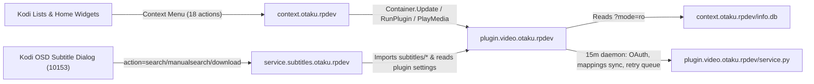

# Otaku-RPDev Complete Feature Reference

Comprehensive capability inventory for the **Otaku-RPDev** tri-addon suite, written for both **end users** (workflows, settings, UI dialogs) and **developers / LLM agents** (module paths, `@Route` endpoints, WindowXML templates, SQLite tables, and extension seams).

> **Related Docs:** [README.md](../README.md) · [ARCHITECTURE.md](ARCHITECTURE.md) · [CONFIGURATION_GUIDE.md](CONFIGURATION_GUIDE.md) · [TESTING.md](TESTING.md) · [CONCERNS.md](CONCERNS.md) · [AGENTS.md](../AGENTS.md)

---

## 1. Suite Architecture & Tri-Addon Overview

Otaku-RPDev ships as three coordinated Kodi add-ons (targeting Kodi 20/21 Nexus/Omega and Kodi 22 Piers):

| Add-on ID | Current Version | Role | Entrypoint(s) |
|---|---|---|---|
| `plugin.video.otaku.rpdev` | `v6.4.11` | Primary video add-on: catalogs, scrapers, debrid, player, watchlists, subtitles engine, WindowXML UI, background daemon | `default.py`, `service.py` |
| `service.subtitles.otaku.rpdev` | `v1.0.3` | Native Kodi `xbmc.subtitle.module` companion bridging Kodi's OSD Subtitle Settings (`Window 10153`) to Otaku's subtitle engine | `service.py` |
| `context.otaku.rpdev` | `v1.0.48` | Global `kodi.context.item` companion adding 18 widget-aware contextual actions + studio/genre artwork packs | `default.py`, `info.db` |

---

## 2. `plugin.video.otaku.rpdev` — Primary Video Add-on

### 2.1 Discovery, Catalogs, Menus & Episode Enrichments

- **Multi-Source Anime Catalogs** (`Main.py`, `OtakuBrowser.py`, `AniListBrowser.py`, `MalBrowser.py`, `AnimeSchedule.py`):
  - **Airing Calendar** (`airing_calendar`): weekly airing schedule enriched with episode counts and synopses.
  - **Curated Lists**: Last / This / Next Season Airing; Trending, Popular, Top Voted, and Favourites across Last Year, This Year, Last Season, This Season, and All Time.
  - **Faceted Filtering & Search** (`routes/search.py`):
    - Year & Season browser (`browse_year_season`, `browse_year/*`, `browse_year_filter/*`) with offline `mappings.db` support.
    - Genre & Format directories (`Main.py`).
    - Persistent Search History (`search`, `remove_search_item/*`, `edit_search_item/*`, clear-history routes).
  - **Visual AniChart Browser** (`windows/anichart.py`, `anichart.xml`): custom grid view for seasonal discovery.
  - **Deep Anime Metadata Views**: Recommendations (`find_recommendations/*`), Franchise Relations (`find_relations/*`), Chronological Watch Order (`watch_order/*`), Reviews (`anime_reviews/*`, `view_review/*`), and Statistics (`anime_statistics/*`, `anime_statistics.xml`).
- **Home & Menu Customization** (`windows/menu_order.py`, `routes/history.py`):
  - Reorderable and toggleable main-menu & category items (`menu_order.xml`, `menu.mainmenu.order`).
  - **Last Watched** banner (`add_last_watched`, `addon.last_watched`) and **Watch History** (`watch_history`, `clear_watch_history`, `clear_last_watched`, `remove_watch_history/*`), with automatic `Container.Refresh` + settings cache clear on playback stop/end so Kodi Home Screen widgets update immediately.
- **Multi-Indexer Metadata & Episode Badges** (`resources/lib/indexers/`):
  - **7 Indexers**: `otaku.py`, `otaku_next_up.py`, `jikanmoe.py`, `anizip.py`, `kitsu.py`, `simkl.py`, `anidb.py`.
  - **13 Endpoint Clients** (`resources/lib/endpoints/`): `anilist.py`, `mal.py`, `malsync.py`, `tmdb.py`, `tvdb.py`, `anidb.py`, `simkl.py`, `mdblist.py`, `fanart.py` (with `_sanitize_art_url` space escaping), `animeschedule.py`, `teamup.py`, `anime_filler.py`, `aniskip.py`, `anime_skip.py`, `introdb.py`.
  - **Spoiler Shield**: `interface.spoilers.hide_thumbs` replaces unwatched episode thumbnails with show fanart/poster; `interface.cleantitles` masks unwatched episode titles/plots.
  - **Airing Countdown & Dub Badges**: `[Airs Tomorrow]` / `[Airs <Day> in Nd]` badges and upcoming dub release timestamps (`endpoints/__init__.py:get_second_label`).
  - **Filler / Canon Episode Tagging** (`indexers/__init__.py`, `endpoints/anime_filler.py`):
    - Appends colorized `[CANON]` (limegreen), `[MIXED]` (yellow), `[FILLER]` (red), and `[RECAP]` (orange) badges when `interface.filler.badges` is enabled.
    - Classifies `Manga Canon`, `Anime Canon`, `Mixed Canon/Filler`, `Filler`, and `Recap`, and defaults untagged episodes in sparse filler-mapped series (e.g., *Bleach* via `mappings.db` `filler_ranges`) to `Canon`.

### 2.2 Multi-Source Scraping, Filtering & Relevance Pipeline

Orchestrated by `MetaBrowser.get_sources()` and `pages/__init__.py` (`Sources.getSources`):

| Category | Active Modules (`resources/lib/pages/`) | Key Capabilities |
|---|---|---|
| **Torrent (6)** | `nyaa`, `animetosho`, `nekobt`, `torrentio`, `bitsearch`, `piratebay` | Parallel episode + `show_pack` queries, hash deduplication, single-batch `Debrid().torrentCacheCheck()`, direct ↔ `translate.goog` failover (`nyaa`, `animetosho`) |
| **Hoster / Usenet (1)** | `easynews` | Cached-only stream search via Easynews credentials |
| **Embed / Direct (5 active)** | `hianime` (`ryu`/`volt`/`ayame` via `megaplay_extractor`/`megacloud_extractor`), `anikoto`, `animepahe`, `gogo` (`gogoanime`), `watchnixtoons2` | Domain-agnostic URL parsing, dynamic mirror selection, MAL-sync slug lookup (`animepahe`), 24h `(mirror, mal_id) -> anime_id` binge cache (`hianime`), embed intro/outro skip hints |
| **Defunct Stubs (3)** | `animixplay`, `aniwave`, `animekai` | Kept as 0ms `[]` no-op stubs for backward compatibility |
| **Cloud & Local (2)** | `debrid_cloudfiles`, `localfiles` | Inspects user debrid cloud folders and configured local media directories |

- **Title Isolation, Scoring & Filtering** (`ui/source_utils.py`, `ui/part_filter.py`):
  - `isolate_show_title()` + `score_title_candidate()` (0–200 scale; exact `>=140`, derivatives `<=40`).
  - `expand_sequel_season_aliases()` applied both pre-Debrid (`filter_sources()`) and post-Debrid (`sortSources()`).
  - `part_filter.filter_sources()` drops Chinese hardsubs, wrong parts, and batch mismatches.
  - `sortSources()` enforces audio filtering and 4-tier relevance gating before quality/size/provider ordering.
- **Interactive Source Select & Rescrape Parity** (`windows/source_select.py`, `windows/sort_select.py`, `windows/filter_select.py`):
  - `Source Select` (`source_select.xml` / `source_select_alt.xml`) displays cached episode sources if present, or scrapes with the full `30s` ceiling and disabled early-exit so slower embed providers (`HiAnime`) appear reliably.
  - `Rescrape` runs the identical scrape pipeline after clearing `episode_sources`, `season_pack` cache, `AdaptiveCircuitBreaker`, and `domains` mirror failure cooldowns.
  - Supports view cycling (`Both` / `Cached` / `Uncached` / `Embeds`), custom sort presets (`sort_select.xml`), and release filtering (`filter_select.xml`).
- **Network, WAF & Circuit Breaker Resilience** (`ui/client.py`, `ui/domains.py`):
  - `AdaptiveCircuitBreaker` (`Window(10000)` persisted; `300s -> 900s -> 3600s` tiers + `HALF_OPEN` recovery).
  - FlareSolverr integration (`returnOnlyCookies: False` for JA3/JA4 TLS parity), fast-fail Turnstile negative caching, HTTP 429 `Retry-After` backoff, and live `domains.json` mirror refresh (`refresh_hianime_domains`).

### 2.3 Debrid, Cloud Management & Downloading

- **7 Supported Debrid / Cloud Backends** (`resources/lib/debrid/`):
  - `RealDebrid`, `Premiumize`, `AllDebrid`, `DebridLink`, `TorBox`, `EasyDebrid`, `Easynews` (with `debrid_cache.py` & `debrid_cloud.py`).
- **Cloud File Manager** (`routes/cloud.py`):
  - Routes: `my_cloud`, `my_cloud/*`, `play_cloud_file/*`, `cloud_create_folder/*`, `cloud_rename_item/*`, `cloud_move_item/*`, `delete_cloud_item/*`, `cloud_purge_stalled/*`.
- **Download Manager** (`windows/download_manager.py`, `download_manager.xml`):
  - Queue and monitor local downloads from source selection or resolver.

### 2.4 Playback, SmartPlay, Failover, Skip Automation & Subtitles

- **Playback Routes & TMDb Helper Bridge** (`routes/playback.py`):
  - `play/*`, `play_movie/*`, `playback_options/*`, `tmdb_helper` (resolves TMDb IDs to Otaku playback).
  - **Unaired Episode Guard**: prompts confirmation before scraping future-dated episodes.
- **SmartPlay & Zero-Wait Pre-Resolved Playback** (`ui/player.py`, `windows/resolver.py`):
  - Reuses cached season packs across binge episodes (`smartplay.reuse_season_pack`).
  - Background pre-scrapes `ep + 1` during active playback, runs `resolve_silent()` (pruning failing lead candidates and saving remaining sources), and hands off directly via `_try_preresolved_handoff()` (with idle `>30m` URL re-probing).
  - **Automatic Failover**: `WatchlistPlayer` rotates to the next candidate on `startup_error`, `premature_eof`, `playback_error`, or `buffer_stall`.
- **Binge UX & Skip Automation** (`windows/playing_next.py`, `windows/still_watching.py`, `windows/skip_intro.py`):
  - `PlayingNext` (`playing_next_*.xml` across 7 skin themes: `default`, `af`, `af2`, `ah2`, `auramod`, `az`, `tb`) + `StillWatching` (`still_watching.xml`) binge safeguard.
  - **3-Tier Chapter & OP/ED Skip Priority**:
    1. Kodi 22 native demuxer chapters (`Player.GetChapters` JSON-RPC)
    2. Pre-probed container chapters (`ffprobe`)
    3. Community skip timestamps (`AniSkip`, `Anime-Skip`, `IntroDB`) with per-series `intro_offset_s` / `outro_offset_s` adjustments.
  - **Scene Marker Jumper** (`step_scene_marker/*`, `scene_markers`): jump to next/previous chapter or skip marker interactively.
  - **Filler Auto-Skip Modes** (`WatchlistPlayer.build_playlist()`):
    - `Skip Filler & Recap` (`skip`): skips `[FILLER]` and `[RECAP]`, replays `[CANON]` and `[MIXED]`.
    - `Skip All Including Mixed` (`skip_mixed`): skips `[RECAP]`, `[MIXED]`, and `[FILLER]`, playing only `[CANON]`.
    - `Keep All Episodes` (`keep`): disables skipping.
- **Audio & Subtitle Intelligence v2** (`ui/player.py`, `ui/embed_extractor.py`, `resources/lib/subtitles/`):
  - **Dual BCP 47 / ISO 639-2 Stream Matching** (`is_language_match`): works uniformly on Kodi 20/21 (`jpn`/`eng`) and Kodi 22 (`ja`/`en`), plus single-track HLS Dub detection (`otaku.active_source_is_dub`).
  - **6 Built-in Subtitle Providers** (`subtitles/services/`): `opensubtitles`, `subdl`, `subsource`, `podnadpisi`, `bsplayer`, `addic7ed`.
  - **Auto-Download & Sparse Sidecar Upgrade**: skips `Mismatch`/`Title Mismatch` results (`MAX_AUTO_ATTEMPTS=6`), aborts if playback stops, strips SDH brackets while preserving ASS `{...}` tags, detects 25fps PAL speedup drift (`rescale_subtitle_timestamps`), and avoids attaching sparse `<45`-cue Signs-only `.vtt` sidecars when Full Dialogue is requested (auto-downloading Full Dialogue instead).
  - **Kodi 22 Subtitle Parser Contract**: BOM/whitespace stripping, cue validation, hour-less VTT promotion, HTML/JSON rejection with origin fallback, and `xbmcvfs.rename()` `g_directoryCache` visibility sync.
- **Per-Series Playback Profiles & Release-Group Pinning** (`windows/series_profile.py`, `series_profile.xml`, `routes/tools.py:series_profile/*`, `routes/tools.py:pin_release_group/*`):
  - Per-show SQLite `series_overrides` (`SCHEMA_VERSION = '1.0.17'`, 11-row editor) for Audio Language, Subtitle Language, Subtitle Mode (`Full Dialogue` / `Signs & Songs` / `Smart Pair`), Preferred Provider, Filler Auto-Skip Mode, Cour `episode_offset` (isolated from scrobbling), Intro/Outro skip offsets (`-30s` to `+30s`), Subtitle Timing Offset (`sub_offset_ms`), **Preferred Release Group** (intra-tier `+25` priority boost in `sortSources()`), and **Excluded Release Groups** (safe filtering with unfiltered fallback when no alternatives remain). Also accessible via 1-click `SourceSelect` context actions and the `context.otaku.rpdev` `Pin Release Group` item.
- **Native Anime Subtitle Providers & Kodi 22 Piers Integrations**:
  - **Jimaku (`jimaku.cc`) & AnimeTosho Attachments**: Native Japanese subtitle lookup via `anilist_id -> mal_id -> kitsu_id -> title` (0 network calls when API key is blank or non-Japanese requested) and AnimeTosho JSON `.ass`/`.srt`/`.xz` attachment extraction with ASS-tag-safe dialogue-only SDH stripping.
  - **Kodi 22 "Piers" Native APIs (`hasattr`-guarded with Kodi 20/21 fallbacks)**: `NF-16` Standby & CEC background throttling (`general.standby_throttling`), `NF-15` muted `ControlVideoWindow` inline AniChart trailer previews (`interface.anichart.inline_trailers`), `DV`/`HDR10`/`HLG` badge surfacing (`detect_hdr_type` + `setHdrType` + `ListItem` mirrors), and Android TV launcher deep links (`@Route('deeplink/*')` with 10s NTP-clamped stale `VIEW` intent replay guard).

### 2.5 Multi-Tracker Watchlist Sync & Progress

- **4 Watchlist Flavors** (`resources/lib/WatchlistFlavor/`, `WatchlistIntegration.py`):
  - `AniList`, `MyAnimeList`, `Kitsu`, `Simkl`.
  - OAuth login modals (`wlf_auth_anilist.xml`, `wlf_auth_mal.xml` with 300s idle watchdog), status browsing (`watchlist/*`, `watchlist_status_type/*`), `next_up` / `next_up_pages/*`, Watchlist Manager (`watchlist_manager/*`), and episode status actions (`marked_as_watched`, `marked_as_unwatched`, `mark_previous_watched`).
- **Multi-Tracker Engine**:
  - Conflict resolution via `watchlist.sync.conflict_policy` (`highest_progress`, `primary_wins`, `latest_updated`).
  - Persistent `scrobble_retry_queue` for HTTP 429/5xx failures (`Retry-After` + exponential backoff, disabled-service cleanup, exhausted `last_error` logging).
  - **Telemetry & Drift Auditor**: `watchlist_telemetry` and `watchlist_drift_auditor` (dry-run preview + confirmed cross-tracker reconciliation).

### 2.6 Background Service Daemon, Databases & Maintenance Tools

- **Background Service (`service.py`)**:
  - Startup: `load_settings()`, `control.process_context()`, `clean_settings()` prune, `database_sync.SyncDatabase()`, OAuth refresh, daily `.xz`/`.gz` `anime_mappings.db` + `anime_metadata.db` ETag sync (SHA-256 + `PRAGMA quick_check` + `.bak` rollback), dub schedule update, watchlist/calendar prefetch, `domains.refresh_domains`, and `MultipageWorker` background pre-cacher.
  - 15-Minute Loop: standby-aware `control.clean_memory()`, proactive OAuth refresh (`600s` pre-expiry), daily mappings check, `scrobble_retry_queue` replay, thread DB connection cleanup, and passive WAL checkpointing.
  - Shutdown: deterministic `<2s` worker join + passive WAL checkpoint + connection pool close.
- **SQLite Architecture** (`ui/database.py`, `ui/database_sync.py`):
  - Read-write WAL (`cache.db`, `search.db`, `malSync.db` with auto column-level migrations).
  - Read-only URI `?mode=ro` (`mappings.db`, `anime_metadata.db`, `context.otaku.rpdev/info.db`) with `mmap_size=0` on low-memory devices.
- **Tools, Diagnostics & Settings** (`routes/tools.py`, `ui/settings_manager.py`):
  - `setup_wizard`, `clear_cache` (`clear_cache.xml` / `clear_scrapers_cache` / `clear_debrid_cache` / `clear_metadata_cache`), `export_settings` / `import_settings` (`settings_backup.xml`, includes `series_overrides`), `vacuum_databases`, `check_db_integrity`, `rebuild_database`, `database_stats`, `scraper_stats`, `system_health_diagnostics` (`textviewer.xml`), `inspect_mappings/*`, `completed_sync`, `clean_settings`, `toggleLanguageInvoker`, `toggle_ipv6`, `toggle_http2`, `webpdb_trace`, `ui_review_window/*`.
  - **12 `settings.xml` Categories**: `general`, `Providers`, `Scraping`, `Cache`, `Playback`, `Subtitles`, `Sort and Filter`, `Accounts`, `Watchlist`, `Menu Customization`, `Context Customization`, `Maintenance` (see [CONFIGURATION_GUIDE.md](CONFIGURATION_GUIDE.md)).

---

## 3. `service.subtitles.otaku.rpdev` — Native Subtitle Companion

Bridges Kodi's built-in OSD **Subtitle settings → Download subtitle** (`Window 10153` / `DialogSubtitles.xml`) directly into `plugin.video.otaku.rpdev`'s subtitle engine (`service.subtitles.otaku.rpdev/service.py`):

- **3 Supported Actions**:
  - `action=search`: parses player/video metadata and queries all 6 enabled providers in parallel.
  - `action=manualsearch`: parses custom keyboard query (`searchstring`, optional `SxxEyy` / episode number) across enabled providers.
  - `action=download`: downloads, extracts archives (`zip`/`rar`/`7z` with episode matching), validates/normalizes subtitles, and stages them in `service.subtitles.otaku.rpdev`'s own profile `temp/` folder (`g_directoryCache` safe).
- **Rich Kodi OSD ListItem Metadata** (`create_subtitle_listitem`):
  - Native Kodi `SYNC` badge (`sync='true'`) for hash/release/auto-identified matches.
  - Native Kodi `CC` badge (`hearing_imp='true'`) for SDH subtitles.
  - Country flag icon (`thumb`), 0–5 star rating (`icon`), and `[AUTO • Reason]` / `[MANUAL]` labels in `label2`.
- **Shared Settings Binding**: binds `control.ADDON_ID` to `plugin.video.otaku.rpdev` so all provider toggles, credentials, and subtitle preferences are configured in one place (*Settings → Otaku RPDev → Subtitles*).

---

## 4. `context.otaku.rpdev` — Global Context Menu Companion

Standalone `kodi.context.item` add-on (`context.otaku.rpdev/addon.xml`, `default.py`) that exposes Otaku actions across in-addon lists **and** Kodi Home Screen widgets:

- **Widget & External Library Resolution** (`_resolve_widget_mal_id`, `_extract_watch_target`, `get_video_info`):
  - Resolves `mal_id`, `episode`, artwork, and metadata from InfoTag `UniqueIDs` (`mal_id`/`mal`), `ListItem` properties (`mal_id`, `otaku.mal_id`), or URL query parameters — enabling context actions on skin widgets outside `plugin://plugin.video.otaku.rpdev/`.
- **18 Contextual Actions** (toggled via `Window(home)` properties synced by `control.process_context()`):
  - **Discovery & Info**: `findrecommendations`, `findrelations`, `getwatchorder`, `viewreviews`, `viewstatistics`, `inspectmappings`
  - **Watchlist & Progress**: `watchlist`, `markedaswatched`, `markedasunwatched`, `markpreviouswatched`, `logout`
  - **Playback & Sources**: `sourceselect`, `rescrape`, `seriesprofile`, `manualsubtitles`
  - **Artwork & Maintenance**: `fanartselect`, `deletefromdatabase`, `clearcache`
- **Bundled Static Assets & Scripts**:
  - `info.db` (read-only `?mode=ro` genre/studio reference dictionary).
  - Deduplicated genre & studio icon packs (`resources/images/genres/`, `resources/images/studios/` — 494+ icons per style, `coloured` and `white`).
  - Maintenance scripts (`scripts/harvest_anime_studios.py`, `scripts/generate_missing_studios.py`).

---

## 5. Developer & LLM Brainstorming / Extension Seams

Quick reference for scoping new features or diagnosing existing subsystems:

- **Adding a Scraper**: Implement `Sources.get_sources(...)` under `plugin.video.otaku.rpdev/resources/lib/pages/`, register in `_TORRENT_MODULES` / `_HOSTER_MODULES` / `_EMBED_MODULES` (`pages/__init__.py`), add setting toggle in `resources/settings.xml`, and route candidate titles through `isolate_show_title` / `score_title_candidate`. Use `.find()` / `.find_all()` only (zero `soupsieve`).
- **Adding a Route or Tool**: Decorate with `@Route(...)` / `@multi_route(...)` in `resources/lib/routes/` (auto-imported via `Main.py`), and wrap any modal `WindowXMLDialog` in `try ... finally: dlg.close(); del dlg` followed by `control.exit_code()`.
- **Adding a Context Menu Action**: Add `<item>` in `context.otaku.rpdev/addon.xml`, dispatch in `context.otaku.rpdev/default.py`, and register the visibility toggle in `settings.xml` + `control.process_context()`.
- **Extending Per-Series Overrides**: Add column in `SyncDatabase._ensure_column_migrations()` (`ui/database_sync.py`), update `set_series_override()` (`ui/database.py`), add `_FIELD_SPECS` entry in `windows/series_profile.py`, and include in `ui/settings_manager.py` backup/restore.
- **Adding a Skin Overlay Variant**: Place `playing_next_<skin>.xml` / `skip_intro_<skin>.xml` / `skip_outro_<skin>.xml` under `resources/skins/Default/1080i/` and wire skin detection in `ui/player.py`.
- **Key Guardrails**: Keep `AGENTS.md` `< 22,000` bytes, maintain Kodi 20/21/22 dual compatibility (`InfoTagVideo`, non-null SWIG strings), keep `news.txt` dividers `<= 32` chars, and run `python3 scripts/verify_all.py --fail-below 65` before committing/releasing.
