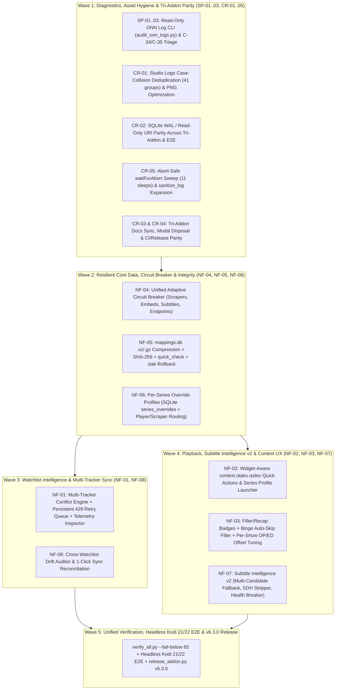

# Otaku-RPDev v6.3.0 Architecture & Phased Sprint Roadmap (`docs/PLANS.md`)

**Baseline Version:** `plugin.video.otaku.rpdev v6.2.19` | `context.otaku.rpdev v1.0.45` | `service.subtitles.otaku.rpdev v1.0.2`  
**Completed Milestone:** **Otaku-RPDev v6.3.0 Major Release** (`plugin.video.otaku.rpdev v6.3.0`, `context.otaku.rpdev v1.0.46`, `service.subtitles.otaku.rpdev v1.0.3` — [QA_SIGNOFF.md](teamwork/sprints/v6.3.0/QA_SIGNOFF.md))  
**Verification Gate:** `python3 scripts/verify_all.py --fail-below 65` + `python3 scripts/e2e_v630_suite.py` + Local Headless Flatpak Kodi 21.3 (Omega) & Kodi 22.0-RC2 (Piers) E2E (`scripts/test_kodi_installs.py`)

---

## 1. Mandatory Environment & Safety Boundary Policy

| Environment | Role | Permitted Operations | Forbidden Operations |
|---|---|---|---|
| **Local Workspace & Unit/Lint Gate** (`/mnt/sharedroot/projects/RPDevs-Builds/Otaku-RPDev`) | Primary engineering & hermetic test sandbox | File edits, AST/doc/quality linters, offline unit & integration tests (`scripts/verify_all.py`) | Escaping above `/mnt/sharedroot/projects/RPDevs-Builds/Otaku-RPDev/`, unmocked network sockets in unit tests, GPG-signed commits |
| **Local Headless Kodi 21/22 E2E Harness** (`tv.kodi.Kodi 21.3-Omega` & `22.0~rc2-Piers` via `xvfb-run` / `scripts/test_kodi_installs.py`) | **ONLY** runtime test bed for addon installs, WindowXML rendering, and E2E playback | Installing test builds, JSON-RPC probing, Xvfb screenshot captures, hermetic & live stream verification | Touching production user hardware |
| **ONN 4K Pro (`10.13.0.16`)** | Production end-user media center | **STRICTLY READ-ONLY LOG REVIEW ONLY** (`http://10.13.0.16:8081/tail?offset=<N>` or read-only `adb shell` log reads) | **NEVER** push code, sideload zips, edit files in place, trigger `UpdateAddonRepos`, mutate `Addons33.db`, or modify configs. Updates arrive strictly via the standard Kodi CDN repository (`https://kodi.repo.iamrp.dev/`). |

---

## 2. Baseline Diagnostic Summary (`v6.2.19` -> `v6.3.0` Gap Audit)

### 2.1 Live Read-Only ONN `10.13.0.16` Review #18 (`offset=225187` -> `433385`)
- **Session Span:** 8-hour overnight real-usage marathon (`2026-11-20 21:15:05` to `2026-11-21 05:15:38`, `1,692` lines / `208,198` bytes).
- **Verified Resolved in Production:**
  - `v6.2.19` hot-updated cleanly at `22:11:38.546` with **0** `clean_settings` orphan re-prunes and **0** `plugin.video.otaku.rpdev` directory failures.
  - **C-32 & C-33 confirmed fixed** on *Blue Exorcist: The Blue Night Saga* (`59226` Ep 12 at `22:13:12`–`22:13:20`): detected 4-cue Signs-only `.vtt`, opened without `OpenStream` error, auto-downloaded full English `.srt`, and rendered via `CDVDSubtitlesLibass`. **Zero** `OpenStream` and **zero** `OnDownloadComplete` errors occurred across the entire 7-hour post-`v6.2.19` session.
  - **8 consecutive Zero-Wait Pre-Resolved Stream Hits** on *Ushio & Tora (2015)* (`29854` Ep 3–10) with native Kodi 22 `Player.GetChapters` (7–9 chapters/episode) and AniSkip auto-skip.
- **Open Concerns Requiring `v6.3.0` Action (4 Total — All Low Severity):**
  - **C-06**: 1 bare `GetDirectory - Error getting plugin://` at `04:49:33` after closing `textviewer.xml` (`change_log` via `RunPlugin`).
  - **C-14**: 16 transient Premiumize CDN (`energycdn.com`) `peer(56)` TCP resets across 3.5h BD 1080p streaming (all recovered in 2.0s on `(re)try 1` with 0 playback stalls; informational/external).
  - **C-34**: Background `resolve_silent()` on `29854 Ep 2` (`01:30:39`) did not prune failing lead `gogo` embed candidate from pre-scraped cache, causing Ep 2 transition (`01:35:57`) to open `resolver.xml` and fail `gogo` again before playing `sources[1]`.
  - **C-35**: `WatchlistIntegration.get_auth_dialog()` lacks `try...finally: dlg.close(); del dlg` disposal and `wlf_auth_*.xml` lacks an idle auto-close timer (blocked Kodi screensaver `window 12600` 8× when left open `04:50`–`05:14`).

### 2.2 Baseline vs. Completed Codebase Metrics (`v6.2.19` -> `v6.3.0`)
- **Baseline Gate (`v6.2.19` under `--fail-below 60`)**: **PASS**
  - `ruff` (`E9,F63,F7,F82,F811,F405,F541`): **0 violations** | `compileall`: **0 errors**
  - `unittest`: **1,035 tests passing**, **0 project warnings**, **100% module / `64.85%` function coverage**
- **Completed `v6.3.0` Gate (`--fail-below 65`)**: **PASS** (**1,070 `unittest` discover + 126 `e2e_v630_suite.py` tests**, **100% module / `66.01%` function coverage**, headless Kodi 21.3 & Kodi 22.0-RC2 **PASS** — see [QA_SIGNOFF.md](teamwork/sprints/v6.3.0/QA_SIGNOFF.md)).
- **Identified `v6.3.0` Codebase Gaps:**
  - **CR-01**: **41 case-insensitive studio logo collision groups** across `context.otaku.rpdev/resources/images/studios/{coloured,white}/` (580 PNGs each, including `8-bit.png`/`8-Bit.png`/`8bit.png`/`Eight Bit.png`/`Eight bit.png`, `bones.png`/`Bones.png`/`BONES.png`, `LIDEN FILMS.png`/`Liden Films.png`, etc.), plus oversized `poster.png` (`1,676,482` bytes × 3 add-ons = `5.03 MB`) and `icon.png` (`437,862` bytes × 3 add-ons = `1.31 MB`).
  - **CR-02**: `scripts/test_kodi_installs.py` opens `cache.db` / `search.db` via raw `sqlite3.connect` without `timeout=30.0`, and `context.otaku.rpdev/info.db` (12 KB static dictionary) should be audited alongside `database.py` WAL/URI read-only invariants.
  - **CR-03**: `service.subtitles.otaku.rpdev` has **0 references** in `AGENTS.md`, `CHANGEREPORT.md`, `docs/ARCHITECTURE.md`, `docs/TESTING.md`, `docs/AUTOMATION.md`, `docs/CONFIGURATION_GUIDE.md`, and `docs/README.md`; `WatchlistIntegration.py:18` and `routes/tools.py:547` invoke `.doModal()` without `try...finally: del dlg`.
  - **CR-04**: `scripts/release_addon.py` and `scripts/test_kodi_installs.py` require first-class tri-addon (`plugin.video.otaku.rpdev`, `context.otaku.rpdev`, `service.subtitles.otaku.rpdev`) version validation, zip packaging verification, and headless Kodi 21/22 E2E coverage.
  - **CR-05**: 11 blocking `time.sleep(...) > 0.5s` calls remain in `AnimeSchedule.py` (`533, 537`), `endpoints/mal.py` (`27, 41`), `indexers/kitsu.py` (`46`), `indexers/anidb.py` (`31`), `indexers/otaku.py` (`62, 120, 243`), and `indexers/jikanmoe.py` (`31, 84`); `control._SENSITIVE_SETTING_KEYS` is missing `subtitles.subdl.apikey`, `subtitles.subsource.apikey`, `subtitles.opensubtitles.password`, and `animeskip.apikey`.

---

## 3. Phased Execution Architecture & Dependency Graph

---

## 4. Detailed Work Package Specifications

### Wave 1: Diagnostics, Asset Hygiene & Tri-Addon Foundation (`SP-01`..`SP-03`, `CR-01`..`CR-05`)
- **SP-01 (Read-Only ONN Log Audit)**: Completed baseline Review #18 (`offset=433385`) in [CONCERNS.md](CONCERNS.md); cataloged `C-34` and `C-35`.
- **SP-02 (Learned-Lessons Codebase Sweep)**: Remediate `C-34` (`resolver.py:resolve_silent()` multi-candidate fallback + pruning failed lead candidates from `database.set_episode_sources`) and `C-35` (`WatchlistIntegration.py` `try...finally` modal disposal + `wlf_auth.py` idle screensaver timeout).
- **SP-03 (Automated Read-Only ONN Log Auditor)**: Create `scripts/audit_onn_logs.py` that reads `docs/CONCERNS.md`'s cursor, fetches `http://10.13.0.16:8081/tail?offset=<N>` strictly read-only, classifies errors/warnings/Zero-Wait hits/subtitle events into structured JSON/Markdown, and optionally formats the next `docs/CONCERNS.md` entry without ever mutating `10.13.0.16`.
- **CR-01 (Studio Case-Collisions & Oversized Assets)**:
  - Canonicalize all 41 case-collision groups across `context.otaku.rpdev/resources/images/studios/coloured/` and `white/` (`580` -> `535` unique lowercase/canonical files, consolidating `8-bit.png`/`8-Bit.png`/`8bit.png`/`Eight Bit.png`/`Eight bit.png` while `control.get_studio_logo()` alphanumeric index resolves every variant in $O(1)$).
  - Losslessly optimize `poster.png` (`1.68 MB` -> `< 350 KB`) and `icon.png` (`438 KB` -> `< 150 KB`) across all 3 add-ons, cutting ~4.5 MB per release bundle.
  - Add an AST/asset lint test in `tests/lint/test_ast_integrity.py` forbidding case-insensitive filename collisions and `> 600 KB` root PNG assets across all 3 add-ons.
- **CR-02 (`v6.2.x` SQLite WAL/URI Parity)**: Ensure every SQLite reader/writer across `plugin.video.otaku.rpdev`, `context.otaku.rpdev`, `service.subtitles.otaku.rpdev`, and `scripts/` honors read-only URI mode (`?mode=ro`) for static dictionaries (`info.db`, `mappings.db`) and `float(timeout)` with WAL mode for mutable databases.
- **CR-03 (Tri-Addon Kodi 21/22 Compliance & Docs Sync)**: Update `AGENTS.md` (keeping `< 22,000` bytes), `CHANGEREPORT.md` (`v6.3.0` addendum), `docs/ARCHITECTURE.md`, `docs/TESTING.md`, `docs/AUTOMATION.md`, `docs/CONFIGURATION_GUIDE.md`, and `docs/README.md` to document the tri-addon architecture (`plugin.video.otaku.rpdev`, `context.otaku.rpdev`, `service.subtitles.otaku.rpdev`). Enforce `try...finally: del dlg` on all `doModal()` call sites (`WatchlistIntegration.py:18`, `routes/tools.py:27, 547`).
- **CR-04 (CI/Release Tri-Addon Packaging Parity)**: Ensure `scripts/release_addon.py` and `scripts/test_kodi_installs.py` validate, package, and smoke-test all 3 add-ons (`plugin.video.otaku.rpdev`, `context.otaku.rpdev`, `service.subtitles.otaku.rpdev`) in lockstep with `.github/workflows/release.yml`.
- **CR-05 (`v6.2.x` Network/TLS/`sanitize_log`/Abort-Safe Parity)**: Replace all 11 remaining blocking `time.sleep(...) > 0.5s` calls in `AnimeSchedule.py`, `endpoints/mal.py`, and `indexers/{kitsu,anidb,otaku,jikanmoe}.py` with abort-responsive `control.monitor.waitForAbort()`, and expand `control._SENSITIVE_SETTING_KEYS` to cover all subtitle & skip-provider API keys/passwords.

### Wave 2: Resilient Core Data, Circuit Breaker & Per-Series Profiles (`NF-04`, `NF-05`, `NF-06`)
- **NF-04 (Unified Adaptive Circuit Breaker)**: Promote `ScraperCircuitBreaker` into a unified `AdaptiveCircuitBreaker` in `resources/lib/ui/domains.py` (backed by `Window(10000)` + SQLite persistence) supporting provider classes (`torrent`, `embed`, `subtitle`, `metadata`, `debrid`) with exponential cooldowns (`300s` -> `900s` -> `3600s`), half-open probe recovery, and 1-click reset in System Health & Diagnostics.
- **NF-05 (Hardened `mappings.db` Sync & Rollback)**: Upgrade `service.py:update_mappings_db()` to support compressed `.xz`/`.gz` transport alongside raw `.db`, verify SHA-256 digest (when manifest header/sidecar is available) and SQLite `PRAGMA quick_check` before atomic replacement, maintain a verified `mappings.db.bak` backup, and auto-rollback if a downloaded image fails integrity verification.
- **NF-06 (Per-Series Override Profiles)**: Add a non-destructive `series_overrides` table in `malSyncDB` (`mal_id PRIMARY KEY`, `audio_lang`, `sub_lang`, `sub_mode`, `preferred_provider`, `intro_offset_s`, `outro_offset_s`, `skip_filler_mode`, `updated_at`). Wire per-series overrides into `WatchlistPlayer` (`setup_audio_and_subtitles`, skip offsets, filler skip) and `pages/__init__.py:sortSources()`, exposed via a fast "Series Playback Profile..." dialog.

### Wave 3: Watchlist Intelligence & Multi-Tracker Sync (`NF-01`, `NF-08`)
- **NF-01 (Multi-Tracker Conflict Engine + 429 Retry Queue + Telemetry Inspector)**:
  - Add a persistent `scrobble_retry_queue` table in `malSyncDB` so failed or HTTP 429/503 scrobble updates across MAL, AniList, Kitsu, and Simkl are queued and retried by `service.py` with exponential backoff.
  - Implement configurable multi-tracker conflict resolution (`highest_episode`, `primary_flavor_wins`, `most_recent_timestamp`) when multiple watchlist flavors are active.
  - Add a "Watchlist & Scrobble Telemetry Inspector" view under Tools -> System Health & Diagnostics.
- **NF-08 (Cross-Watchlist Drift Auditor)**: Build a comparative drift analyzer in `WatchlistIntegration.py` & `routes/tools.py` that diffs episode progress and watch status across all enabled watchlist accounts (AniList, MAL, Kitsu, Simkl) and local SQLite watch history, offering 1-click reconciliation (Primary $\rightarrow$ All or Merge Highest Progress).

### Wave 4: Playback, Subtitle Intelligence v2 & Context UX (`NF-02`, `NF-03`, `NF-07`)
- **NF-02 (Widget-Aware `context.otaku.rpdev` Quick Actions)**: Enhance `context.otaku.rpdev` (`v1.0.46`) to resolve `mal_id` and `episode` from third-party skin widget items (Arctic Horizon 2, AuraMOD, Estuary widgets via `ListItem.Property(mal_id)` / URL query / `info.db` lookup) and expose quick actions including **Series Playback Profile** (`NF-06`) and **Auto-Download Subtitles / Manual Search**.
- **NF-03 (Filler/Recap Badges + Binge Auto-Skip Filler + OP/ED Offset Tuning)**:
  - Enrich episode listings in `indexers/__init__.py` with colorized `[FILLER]` / `[RECAP]` / `[MIXED CANON/FILLER]` badges from `anime_filler.py` + `episodes.filler`.
  - Add optional **Binge Auto-Skip Filler Episodes** (`smartplay.skip_filler`) in `WatchlistPlayer.build_playlist()` / Zero-Wait progression (with OSD notification when skipping a filler episode) and per-series OP/ED offset tuning (`NF-06`).
- **NF-07 (Subtitle Intelligence v2)**:
  - Add multi-candidate download fallback in `subtitles/__init__.py:auto_download_subtitles()` (if candidate #1 fails download, archive episode match, or Kodi 22 cue validation, automatically fall through to candidate #2..#N).
  - Add optional SDH hearing-impaired bracket/speaker tag stripping (`subtitles.strip_sdh_tags`) in `subtitles/download.py` when `subtitles.prefer_sdh=false`.
  - Wire subtitle providers into the `NF-04` adaptive circuit breaker so timing-out subtitle APIs don't delay playback startup.

---

## 5. Risk Register & Mitigations

| Risk ID | Description | Likelihood | Impact | Mitigation |
|---|---|---|---|---|
| **R-01** | `AGENTS.md` exceeds Antigravity's 24 KB per-file context budget when adding `v6.3.0` rules | Medium | High | Keep `AGENTS.md` strictly `< 22,000` bytes (enforced by `test_docs_and_customizations.py`); place detailed architectural diagrams in `docs/ARCHITECTURE.md` and `docs/PLANS.md`. |
| **R-02** | Circular `<requires>/<import>` dependency across the 3 add-ons freezes Kodi 22 `DialogAddonInfo.xml` (lesson from `C-27`) | Low | Critical | `context.otaku.rpdev` and `service.subtitles.otaku.rpdev` must ONLY import `xbmc.python`; enforced mechanically by `test_zero_circular_addon_dependencies`. |
| **R-03** | Bypassing `xbmcvfs` when writing temp files causes Kodi 22 `g_directoryCache` misses (`C-30`/`C-33`) | Low | High | Always route temp file writes through `control.atomic_write_text()` (`xbmcvfs.rename` + `special://temp/` URI awareness) and never call `xbmcvfs.listdir()` in `del_subs()`. |
| **R-04** | Multi-agent `/teamwork` edit collisions on shared files (`control.py`, `database.py`, `player.py`, `settings.xml`) | Medium | Medium | Assign strict file ownership per wave/worker in `docs/teamwork/SPRINT_BOARD.md` and require `scripts/verify_all.py` green before landing each wave. |
| **R-05** | SQLite schema migrations for `series_overrides` / `scrobble_retry_queue` affecting existing user `malSync.db` | Low | High | Use idempotent `CREATE TABLE IF NOT EXISTS` inside `SyncDatabase._create_all_tables()` and bump `SCHEMA_VERSION` non-destructively via `_migrate_database()`. |

---

## 6. Quantitative Definition of Done (`v6.3.0` — Verified Complete)

1. **Zero Runtime Regressions:** `python3 scripts/verify_all.py --fail-below 65` passes all 4 offline silos (`ruff`, `compileall`, `unittest` with `-W error::DeprecationWarning:resources -W error::ResourceWarning:resources`, and `audit_function_coverage.py` at **100% module coverage** and **`66.01%` function coverage**, up from `64.85%`).
2. **Test Suite Expansion:** **1,070 `unittest` discover + 126 `e2e_v630_suite.py` tests** with zero placeholder tests (`test_suite_quality.py`).
3. **Asset & Lint Cleanliness:** Zero case-insensitive studio logo filename collisions across `context.otaku.rpdev` (`530` canonical PNGs per style), all root `poster.png`/`icon.png` assets optimized (`112.8 KB` / `31.9 KB`), and `AGENTS.md < 22,000` bytes.
4. **Dual Headless Kodi 21 & 22 E2E Verification:** `python3 scripts/test_kodi_installs.py --versions 21 22 --mode hermetic` passes 15/15 gates across all 3 add-ons (`plugin.video.otaku.rpdev v6.3.0`, `context.otaku.rpdev v1.0.46`, `service.subtitles.otaku.rpdev v1.0.3`) with 0 C++ setting deserialization errors, 0 SWIG leaks, and 0 Python tracebacks ([QA_SIGNOFF.md](teamwork/sprints/v6.3.0/QA_SIGNOFF.md)).
5. **Release & CDN Verification:** Published via GitHub Actions tag `v6.3.0` (Run `#44914758602`) to GitHub Releases and verified HTTP 200 live on `https://kodi.repo.iamrp.dev/` with zero direct modifications to `10.13.0.16`.

---

## 7. Post-`v6.3.0` Forward Roadmap (`v6.4.0` Backlog: `NF-10`–`NF-17` & Deferred Sub-Features)

Items intentionally scoped beyond `v6.3.0` and scheduled for **`v6.4.0`**:

- **`NF-10` — Offline Watchlist & Metadata Snapshot Bundles**: Exportable/importable encrypted `.tar.xz` snapshot bundles containing `malSync.db`, `search.db`, and user `series_overrides` for 1-click LAN migration between Kodi devices.
- **`NF-11` — Adaptive Debrid Multi-Host Failover & Stream Health Telemetry**: Mid-playback CDN stall detector (`CURL-56` frequency monitor) that automatically re-resolves an alternate debrid CDN mirror or secondary cached torrent hash at the current playback timestamp.
- **`NF-12` — Custom WindowXML Series Profile Editor & Per-Season Rule Matrix**: Dedicated skin-themed `series_profile.xml` WindowXMLDialog with per-cour/per-season `episode_offset`, custom regex release group pinning, and visual OP/ED timestamp preview.
- **`NF-13` — Local LAN Peer Cache Discovery (mDNS / ZeroConf)**: Optional opt-in read-only SQLite metadata & `mappings.db` LAN peer sync so secondary Kodi boxes on the same home subnet reuse pre-fetched metadata without redundant upstream API calls.
- **`NF-14` — Kodi 22 Native Scene-Marker Stepping**: Leverage Kodi 22 `Chapters` / EDL scene-marker APIs for instant OSD skip-to-chapter navigation alongside AniSkip/IntroDB bounds.
- **`NF-15` — Embedded `ControlVideoWindow` Trailer Preview**: Render inline muted trailer previews inside `anichart.xml` / info dialogs via Kodi 22 video control windows without leaving menu context.
- **`NF-16` — `getDevicePowerStatus()` Background Throttling**: Read Kodi 22/Android power-state hints in `service.py` to pause background precaching/WAL checkpoints during battery or standby states.
- **`NF-17` — Debrid Cloud Quota & Active-Transfer Guard**: Pre-check Debrid storage quota and active slot saturation before pinning season packs (`realdebrid`, `premiumize`, `torbox`, `alldebrid`), auto-pruning oldest expired transfers when full.
- **Deferred `NF-02` Sub-Features (`context.otaku.rpdev v1.1.0`)**:
  - Direct context-menu *"Copy Diagnostics Summary"* and *"Pin Release Group for Series"* quick actions on episode rows.
- **Deferred `NF-07` Sub-Features (`service.subtitles.otaku.rpdev v1.1.0`)**:
  - Automatic ASS/SRT dialogue timing shift calibration (`±ms` audio-energy / chapter-boundary alignment) and multi-language dual-subtitle (`jpn` + `eng` top/bottom ASS) muxing.

