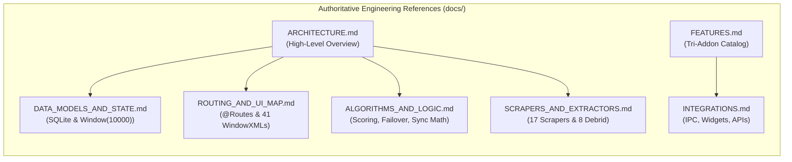

# Otaku-RPDev Architecture Roadmap & Release Milestone Ledger (`docs/PLANS.md`)

**Active Production Release:** `plugin.video.otaku.rpdev v6.8.0` | `service.otaku.rpdev v1.1.0` | `context.otaku.rpdev v1.0.50` | `service.subtitles.otaku.rpdev v1.0.3`  
**Completed Major Milestones:** `v6.3.0` ([QA_SIGNOFF.md](teamwork/sprints/v6.3.0/QA_SIGNOFF.md)) → `v6.4.0`–`v6.4.11` ([CONCERNS.md](CONCERNS.md))  
**Verification Gate:** `python3 scripts/verify_all.py --fail-below 65` + `python3 scripts/e2e_v630_suite.py` + Local Headless Flatpak Kodi 21.3 (Omega) & Kodi 22.0-RC2 (Piers) E2E (`scripts/test_kodi_installs.py`)

---

## 1. Mandatory Environment & Safety Boundary Policy

| Environment | Role | Permitted Operations | Forbidden Operations |
|---|---|---|---|
| **Local Workspace & Unit/Lint Gate** (`/mnt/sharedroot/projects/RPDevs-Builds/Otaku-RPDev`) | Primary engineering & hermetic test sandbox | File edits, AST/doc/quality linters, offline unit & integration tests (`scripts/verify_all.py`, `scripts/qa_fast.py`) | Escaping above `/mnt/sharedroot/projects/RPDevs-Builds/Otaku-RPDev/`, unmocked network sockets in unit tests, GPG-signed commits |
| **Local Headless Kodi 21/22 E2E Harness** (`tv.kodi.Kodi 21.3-Omega` & `22.0~rc2-Piers` via `xvfb-run` / `scripts/test_kodi_installs.py`) | **ONLY** runtime test bed for addon installs, WindowXML rendering, and E2E playback | Installing test builds, JSON-RPC probing, Xvfb screenshot captures, hermetic & live stream verification | Touching production user hardware |
| **ONN 4K Pro (`10.13.0.16`)** | Production end-user media center | **STRICTLY READ-ONLY LOG REVIEW ONLY** (`http://10.13.0.16:8081/tail?offset=<N>` via `scripts/audit_onn_logs.py --concerns docs/CONCERNS.md`) | **NEVER** push code, sideload zips, edit files in place, trigger `UpdateAddonRepos`, mutate `Addons33.db`, or modify configs. Updates arrive strictly via the standard Kodi CDN repository (`https://kodi.repo.iamrp.dev/`). |

---

## 2. Current Baseline & Verification Metrics (`v6.4.11+` Core Hardening Sprint)

- **Unified Offline Verification Gate (`python3 scripts/verify_all.py --fail-below 65`)**: **PASS**
  - **Silo 1 (`ruff`)**: `E9,F63,F7,F82,F811,F405,F541` across all 3 add-ons and `tests/` — **0 violations**.
  - **Silo 2 (`compileall`)**: Bytecode compilation across Python 3.11–3.14 — **0 errors**.
  - **Silo 3 (`unittest`)**: **1,160 unit, integration, A/B parity, and lint tests passing** under strict project warnings-as-errors (`-W error::DeprecationWarning:resources -W error::ResourceWarning:resources`).
  - **Silo 4 (`coverage`)**: **100.0% module coverage (`145/145` files)** and **`75.7%` function coverage** (`>= 75.0%` sprint target achieved) via zero-overhead PEP 669 `sys.monitoring`.
- **Opaque-Box E2E Suite (`python3 scripts/e2e_v630_suite.py`)**: **147/147 tests passing** across `suite_sp.py`, `suite_cr.py`, and `suite_nf.py` (see [TESTS.md](TESTS.md)).
- **Live Read-Only ONN `10.13.0.16` Telemetry ([CONCERNS.md](CONCERNS.md) Review #27, `offset=309114`)**:
  - `R-01` through `R-58` verified resolved across production and local E2E.
  - `C-37` proactive 32-bit ARM RSS/VmSize memory guard (`900 MB` RSS / `2600 MB` VmSize + `<85%` hysteresis + `MultipageWorker` throttle + `filecache.memorysize > 64 MB` diagnostics warning) upgraded locally to `FIXED_VERIFIED_LOCAL_E2E`. Only passive watch items (`C-14`, `C-35`, `C-37` live marathon telemetry confirmation) remain.

### 3.4 Core Hardening, `NF-17`, Subtitle Calibration & Coverage Expansion Sprint (`WS-1`–`WS-8`)
- **`WS-1` (Proactive 32-Bit ARM Memory Watermark Guard, `C-37`)**: Lowered `general.memory_watermark_mb` default to `900 MB` (`512–2048 MB`), added `2600 MB` VmSize guard, `libc.so.6` `malloc_trim(0)` -> Bionic `libc.so` `mallopt(-101, 0)` native heap trim fallback, `<85%` hysteresis clearing (`otaku.memory_pressure`), `MultipageWorker` pause/throttle, and `tools.py` `filecache.memorysize > 64 MB` warning.
- **`WS-2` (Shared 15s DNS/Connectivity Gate)**: Added thread-safe `ConnectivityGate` (`>= 2` distinct hostnames within 5s or failed internet probe) gating `client.request()` for `<= 15s` and protecting `AdaptiveCircuitBreaker` from false cooldown escalation during transient DNS drops.
- **`WS-3` (Latency-Aware Adaptive Scrape Deadlines)**: Added bounded `<= 20`-sample per-provider latency ring buffer (`database.record_provider_latency` / `get_provider_p90_latencies`), granting a bounded embed grace (`+2s..+8s` p90 or `4.0s` cold-start) only when cached torrent yield is `0` while honoring `abort_requested()`.
- **`WS-4` (`NF-17` Debrid Cloud Quota Guard & Opt-In Lazy Probe)**: Implemented `ensure_cloud_capacity()` across Real-Debrid, Premiumize, TorBox, and AllDebrid (`debrid.quota_guard=true`, preserving healthy items when `0` stalled exist), plus opt-in `debrid.lazy_cache_probe` (`false` default) probing top-3 Tier-3 candidates (`<= 6s` cap, persisting positive hits only).
- **`WS-5` (Chapter-Aligned Auto Subtitle Calibration)**: Added SQLite `series_overrides.sub_offset_ms` (`SCHEMA_VERSION = '1.0.16'`, 9th `SeriesProfileDialog` row), opt-in `subtitles.auto_calibrate_chapters` (`false` default) requiring multi-boundary corroboration (`±3s..±12s` within `±1.5s`), and full `service.subtitles.otaku.rpdev` OSD parity.
- **`WS-6`–`WS-8` (Coverage `75.7%`, Staged PNG Optimization & `OTAKU_METRIC` Telemetry)**: Added browser, debrid, Kitsu watchlist, embed extractor, `context.otaku.rpdev/addon.xml` visibility matrix, and `NF-17`/`C-37` E2E tests (`503` total settings verified); added `scripts/optimize_addon_assets.py` (scanning `1,440` PNGs across `8` icon themes) + staged `oxipng` hook in `.github/workflows/release.yml`; added `control.log_metric()` markers parsed by `scripts/audit_onn_logs.py --metrics-out`.

---

## 3. Delivered Architecture Milestones (`v6.3.0` → `v6.4.11`)

### 3.1 `v6.3.0` Tri-Addon Foundation & Resilience Wave (`SP-01..03`, `CR-01..05`, `NF-01..08`)
- **Diagnostics & Asset Hygiene**: Created strictly read-only `scripts/audit_onn_logs.py` (`SP-03`), deduplicated 41 case-insensitive studio logo groups across `context.otaku.rpdev` (`530` canonical PNGs per theme) and optimized root `poster.png`/`icon.png` assets (`CR-01`), enforced SQLite WAL vs. `?mode=ro` URI separation (`CR-02`), converted all 11 remaining `>0.5s` blocking sleeps to `control.monitor.waitForAbort()` (`CR-05`), and locked tri-addon CI/release parity (`CR-03`, `CR-04`).
- **Core Data & Personalization**: Shipped the 3-tier `AdaptiveCircuitBreaker` (`300s -> 900s -> 3600s` + half-open recovery, `NF-04`), compressed `.xz`/`.gz` + SHA-256 + `PRAGMA quick_check` + `.bak` rollback for `mappings.db` (`NF-05`), and the `series_overrides` SQLite table (`NF-06`).
- **Watchlist & Playback Intelligence**: Shipped multi-tracker conflict resolution (`highest_progress`, `primary_wins`, `latest_updated`) + durable `scrobble_retry_queue` (`NF-01`), Cross-Watchlist Drift Auditor (`NF-08`), widget-aware `context.otaku.rpdev` (`NF-02`), filler/recap badges & auto-skip (`NF-03`), and Subtitle Intelligence v2 (`NF-07`).

### 3.2 `v6.4.0`–`v6.4.6` Failover, WindowXML Series Profile & Dual-DB Offline Enrichment
- **`NF-11` (4-Reason Mid-Stream & Startup Failover)**: Implemented `WatchlistPlayer` automatic failover across startup timeout, `onPlayBackError`, premature EOF (`< 80%`), and repeated buffer stalls, re-resolving the next ranked candidate at the current timestamp.
- **`NF-12` (Custom `SeriesProfileDialog` WindowXML)**: Upgraded per-series overrides (`series_profile.xml` + [`windows/series_profile.py`](../plugin.video.otaku.rpdev/resources/lib/windows/series_profile.py)) into a full 9-row skin-themed `WindowXMLDialog` with quick diagnostic buttons (`Inspect Mappings`, `Clear Show Cache`, `Rescrape Episode`) and per-cour `episode_offset`.
- **`NF-14` (Kodi 22 Native Scene-Marker Stepping)**: Merged Kodi 22 `Player.GetChapters` demuxer boundaries with `AniSkip`/`Anime-Skip`/`IntroDB` markers (`otaku.scene_markers`, `step_scene_marker/*`, `scene_markers`).
- **`Otaku-Mapping-DB` Dual-DB Sync (`mappings.db` + `anime_metadata.db`)**: Wired daily and on-demand sync (`service.py:update_mappings_db()`, `update_metadata_db()`) to fetch both `mappings.db` and `anime_metadata.db` with `.etag` sidecars, SHA-256 verification, and offline FTS5 title search (`database.enrich_rows_from_metadata_db()`).

### 3.3 `v6.4.7`–`v6.4.11` Playback Polish, 4-Tag `[CANON]` Parity & Binge Caching
- **`Source Select` & `Rescrape` `30s` Non-Early-Exit Parity (`v6.4.7`)**: Unified `Source Select` (`source_select=true`) and `Rescrape` (`rescrape=true`) under `is_rescrape=True` with a `30s` scraper timeout floor, early-exit disabled, and HiAnime mirror cooldown reset.
- **Home Screen Widget Refresh on Stop (`v6.4.7`)**: Added `WatchlistPlayer._refresh_widgets_on_stop()` (`control.clearSettingsCache()` + `Container.Refresh`) across `onPlayBackEnded`, `onPlayBackStopped`, and `onPlayBackError`.
- **Sparse Signs-Only `.vtt` Skip in Full Dialogue Mode & Subtitle Abort Guard (`v6.4.7`)**: Detected `< 45`-cue Signs-only `.vtt` tracks on English Dub streams and skipped attaching them in Full Dialogue mode so `service.subtitles.otaku.rpdev` auto-downloads complete dialogue subtitles; added episode-mismatch and playback-stop abort guards to `subtitles/search.py` and `subtitles/download.py`.
- **24h HiAnime `(mirror, mal_id) -> anime_id` Binge Cache & Scrobble Hygiene (`v6.4.8`)**: Cached resolved HiAnime show slugs per mirror for 24h in `_scrape_mirror()` and pruned disabled tracker services from `scrobble_retry_queue` when `enabled_watchlists()` is non-empty.
- **`SeriesProfileDialog` Close Fix (`v6.4.9`), 4-Tag `[CANON]` Badges (`v6.4.10`) & Fanart URL Encoding (`v6.4.11`)**: Fixed `BaseWindow.close()` ordering in `SeriesProfileDialog`, added `[CANON]` (Green) badges alongside `[MIXED]`, `[FILLER]`, and `[RECAP]` (defaulting untagged episodes in sparse filler lists like *Bleach* to `Canon`), and percent-encoded spaces (`%20`) in `endpoints/fanart.py`.

---

## 4. Subsystem Architecture & Reference Map

---

## 5. Risk Register & Active Mitigations

| Risk ID | Description | Likelihood | Impact | Active Mechanical Mitigation |
|---|---|---|---|---|
| **R-01** | `AGENTS.md` exceeds Antigravity's 24 KB per-file context budget | Low | High | `test_docs_and_customizations.py` enforces `< 19,500` byte soft warning and `< 22,000` byte hard limit; detailed schemas and formulas live in `docs/*.md`. |
| **R-02** | Circular `<requires>/<import>` dependency across the 3 add-ons freezes Kodi 22 `DialogAddonInfo.xml` (`C-27`) | Low | Critical | `context.otaku.rpdev` and `service.subtitles.otaku.rpdev` import **only** `xbmc.python`; enforced by `test_ast_integrity.py`. |
| **R-03** | Bypassing `xbmcvfs` or reusing subtitle filenames causes Kodi 22 `g_directoryCache` misses (`C-30`/`C-33`) | Low | High | `control.atomic_write_text()` + unique per-play `sub_tag` nonces in `resolver.py` and `routes/playback.py`. |
| **R-04** | `BaseWindow.close()` short-circuiting if `self._win_closed = True` is set before `self.close()` (`R-56`) | Low | High | Window subclasses must call `self.close()` before setting `_win_closed = True`, covered by `test_windowxml_event_dispatch.py`. |
| **R-05** | SQLite schema evolution across existing user `malSync.db` installations | Low | High | Idempotent `CREATE TABLE IF NOT EXISTS` + `PRAGMA table_info` column probes in `database.py` and `database_sync.py`. |

---

## 6. Quantitative Definition of Done (Release & Sprint Gate)

Every feature branch and release must satisfy all five gates before tag push:
1. **Fast Pre-Commit Gate**: `python3 scripts/qa_fast.py` passes in `< 30s` (`ruff`, `compileall`, AST/quality/doc linters, targeted unit tests).
2. **Full 4-Silo Offline Gate**: `python3 scripts/verify_all.py --fail-below 65` passes with 0 ruff errors, 0 compileall errors, 0 project `DeprecationWarning`/`ResourceWarning`, **100% module coverage**, and **`>= 65%` function coverage** (currently `68.59%`).
3. **Opaque-Box E2E Suite**: `python3 scripts/e2e_v630_suite.py` passes `145/145` tests.
4. **Single-Command Release & CDN Verification**: `python3 scripts/release_addon.py --bump patch --title "<Banner <=32 chars>" -m "<Bullets>"` verifies both gates in parallel, tags `--no-sign`, pushes `main` + `vX.Y.Z`, and confirms HTTP 200 on GitHub Releases and `https://kodi.repo.iamrp.dev/`.
5. **Post-Release Passive Read-Only Telemetry**: `python3 scripts/audit_onn_logs.py --concerns docs/CONCERNS.md` confirms zero regressions on `10.13.0.16` after standard Kodi repository auto-update.

---

## 7. Forward Strategic Roadmap (`v6.5.0+` Backlog)

### 7.1 Forward Backlog (`NF-10`, `NF-13`, `NF-15`–`NF-16`)
- **`NF-10` — Offline Watchlist & Metadata Snapshot Bundles**: Exportable/importable `.tar.xz` snapshot bundles containing `malSync.db`, `search.db`, and `series_overrides` for 1-click LAN migration between Kodi devices.
- **`NF-13` — Local LAN Peer Cache Discovery (mDNS / ZeroConf)**: Opt-in read-only SQLite metadata & `mappings.db`/`anime_metadata.db` LAN peer sharing across secondary Kodi boxes on the same home subnet.
- **`NF-15` — Embedded `ControlVideoWindow` Trailer Preview**: *Delivered in Track C (`interface.anichart.inline_trailers`, `anichart.xml` preview overlay `2050`/`2051`/`2052`, YouTube addon gate, `windowed=True` muted playback, `otaku.preview_mode` scrobble suppression, Kodi 20/21 no-op fallback).*
- **`NF-16` — `getDevicePowerStatus()` Background Throttling**: *Delivered in Track C (`general.standby_throttling`, string/integer CEC power states, Kodi 20/21 DPMS/screensaver fallback only on unknown/unavailable, and prompt OAuth/scrobble retry catch-up on standby→resumed transitions).*
- **`NF-17` — Debrid Cloud Quota & Active-Transfer Guard**: *Delivered in WS-4 (`debrid.quota_guard` & opt-in `debrid.lazy_cache_probe`).*
- **Multi-Select Release-Group Sorting & Filtering, Native Anime Subtitles & Kodi 22 HDR/Deep Links**: *Delivered (`SCHEMA_VERSION = '1.0.17'`, 11-row `SeriesProfileDialog` with 40-group multi-select + custom entry, `Settings > Sort and Filter` global `general.release_group.*` + tie-break modes, `context.otaku.seriesprofile` toggle with 18 context items, `JimakuService` & `AnimetoshoSubtitleService` with `.xz` support, `detect_hdr_type` + `setHdrType` surfacing, and `@Route('deeplink/*')` with 10s NTP-clamped replay guard).*

### 7.2 Test & Coverage Expansion Priorities (`P1`–`P3` from [`docs/TESTS.md`](TESTS.md))
- **Priority 1 (`routes/tools.py` & `ui/settings_manager.py`)**: Raise function coverage from ~45% to >=75% via parameterized hermetic route tests.
- **Priority 2 (`WatchlistFlavor/{Simkl,Kitsu,Mal,AniList}.py` & `debrid/{debrid_link,all_debrid,easynews}.py`)**: Raise function coverage from ~50% to >=78% across pagination, token refresh, and season-pack selection branches.
- **Priority 3 (`windows/{anichart,sort_select,stats_window}.py` & `endpoints/teamup.py`)**: Raise WindowXML interaction coverage under `KodiProfile('22', strict_skin_controls=True)` to push repository-wide function coverage past **`72.0%+`**.
